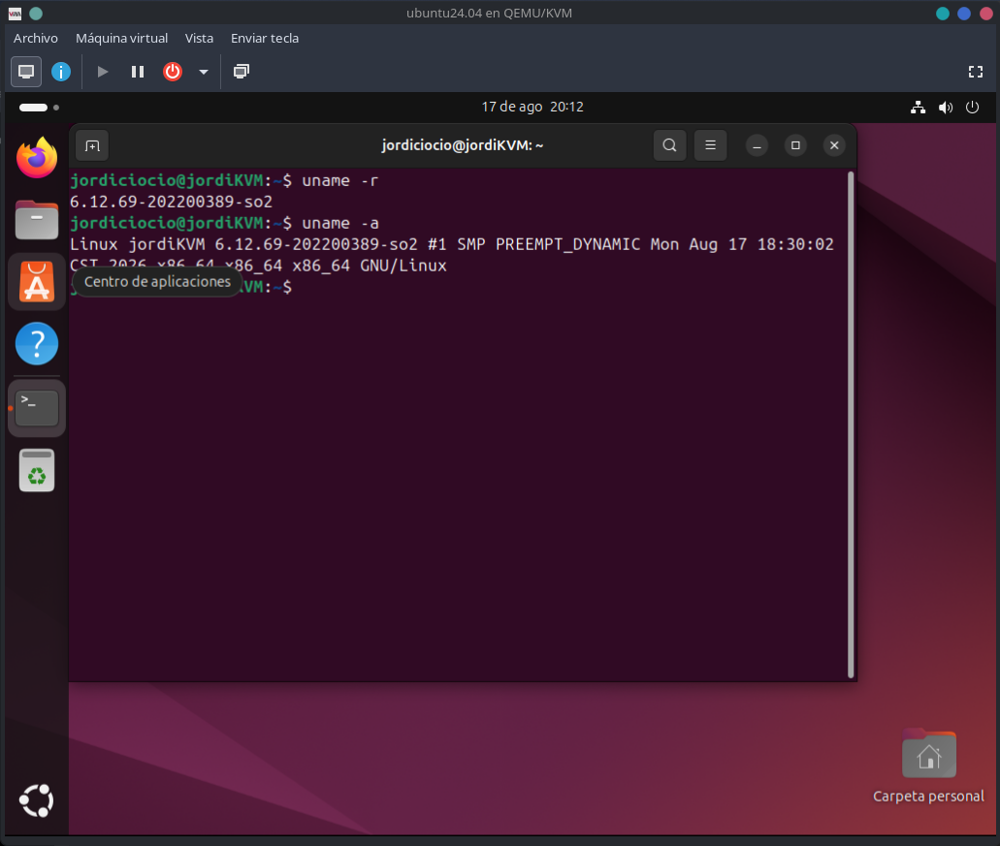

# Práctica 1 - Modificación de funciones del Kernel

**Curso:** Sistemas Operativos 2  
**Carné:** 202200389  
**Kernel base:** Linux 6.12.69  
**Kernel modificado:** `6.12.69-202200389-so2`

## Descripción

En esta práctica se modificó el código fuente del kernel Linux para agregar un contador global a la llamada al sistema `getpid()`.

También se implementó una nueva llamada al sistema denominada `getpid_counter()`, registrada con el número `548`. Esta syscall permite consultar el valor actual del contador y escribirlo en los registros del kernel mediante `printk()`.

El funcionamiento fue comprobado mediante un programa desarrollado en C y posteriormente validado utilizando el comando `dmesg`.

## Estructura del proyecto

```text
Practica_1_2S2026/
├── README.md
├── docs/
│   └── Informe_Tecnico.md
├── img/
├── linux 6.12.69/
│   ├── arch/x86/entry/syscalls/syscall_64.tbl
│   ├── include/linux/syscalls.h
│   └── kernel/sys.c
└── programa_intermedio/
    └── prueba.c
```

## Resultado

El kernel personalizado fue compilado, instalado y ejecutado correctamente.

Para verificar la versión utilizada se ejecutó:

```bash
uname -r
```

Resultado:

```text
6.12.69-202200389-so2
```



La nueva syscall también fue comprobada mediante el programa `prueba.c` y los mensajes generados con `printk()` fueron visibles utilizando `dmesg`.

## Informe técnico

El procedimiento completo, las modificaciones realizadas y las evidencias de configuración, compilación y pruebas se encuentran en el siguiente documento:

[Ver Informe Técnico](docs/Informe_Tecnico.md)
