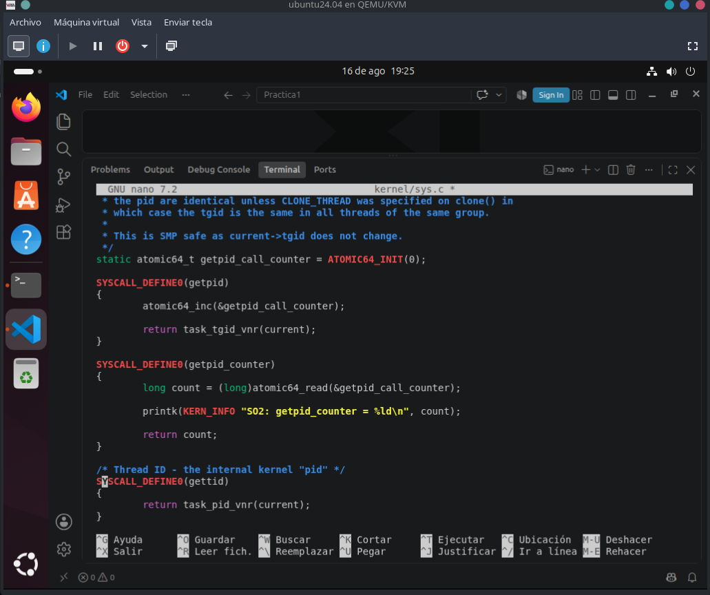
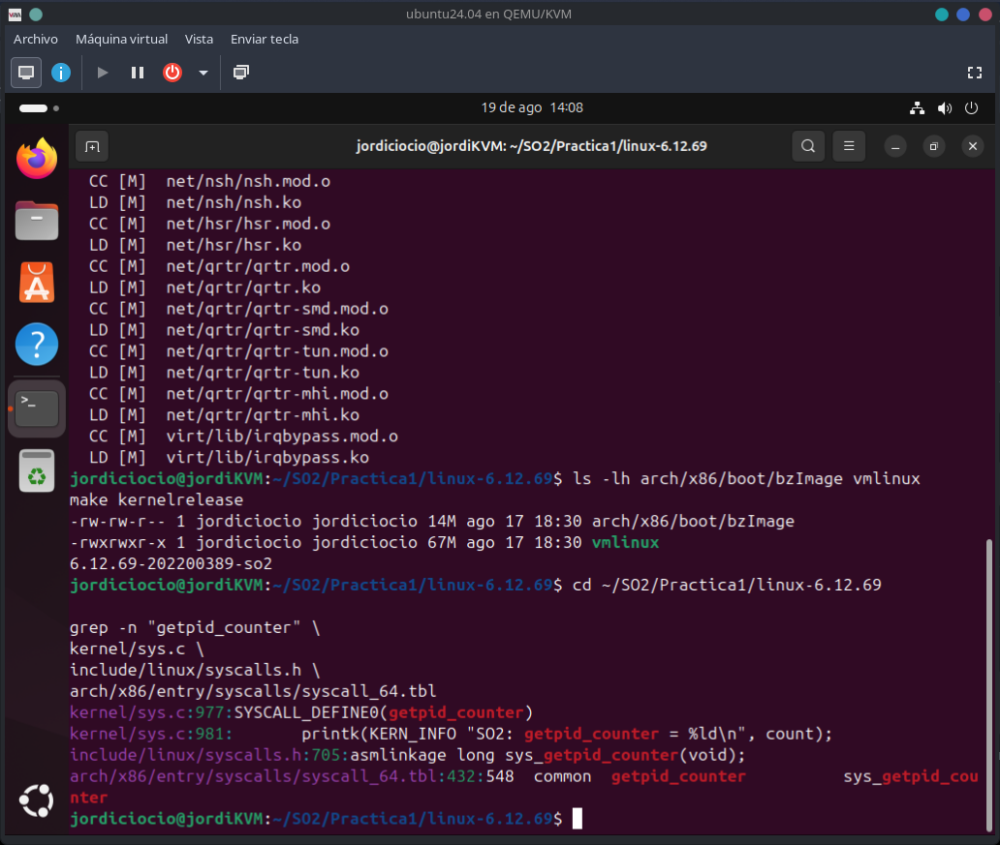
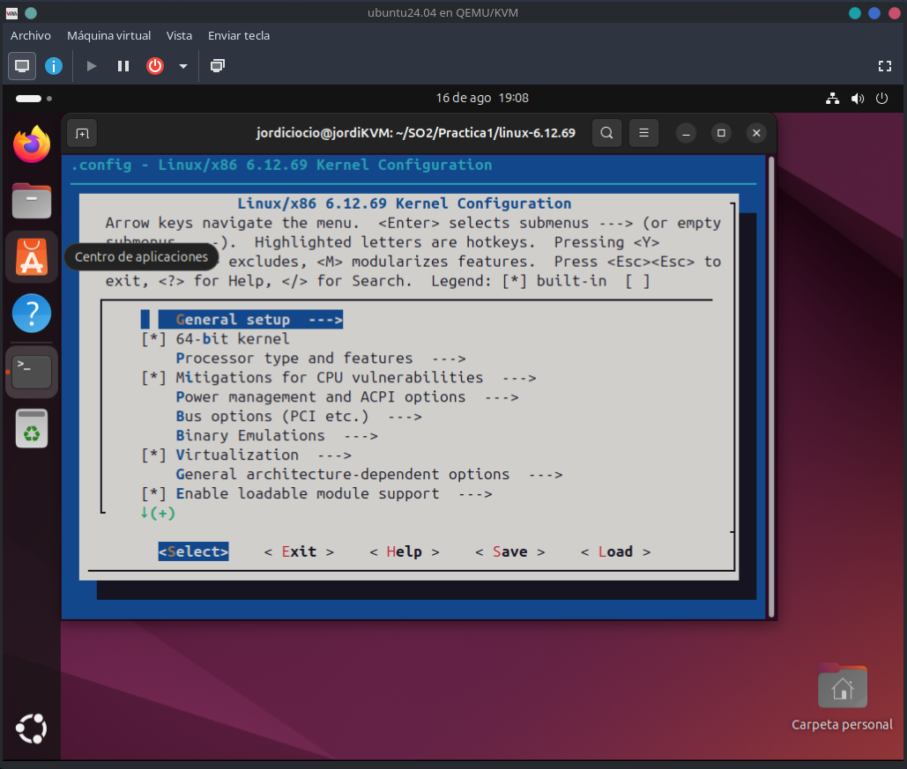
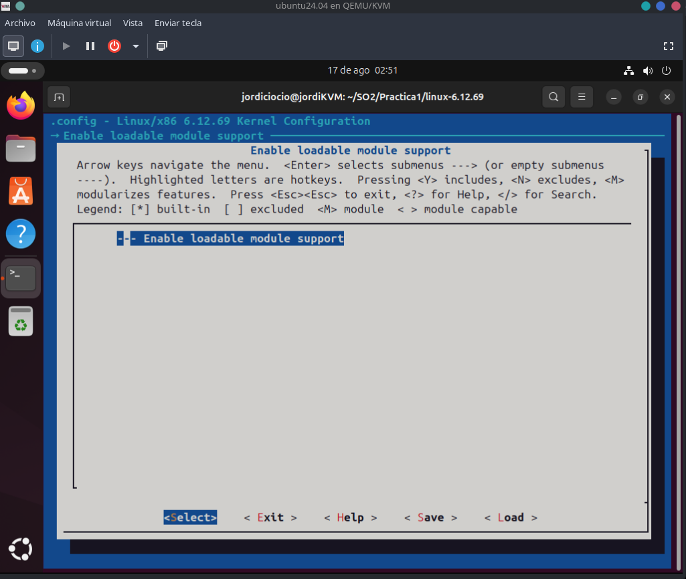
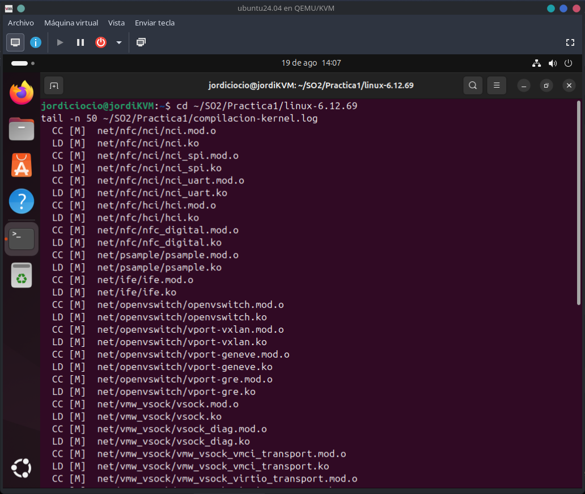
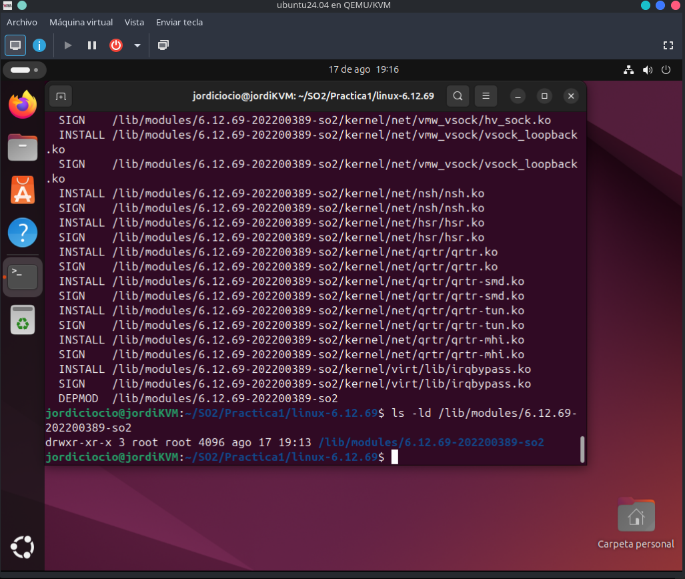
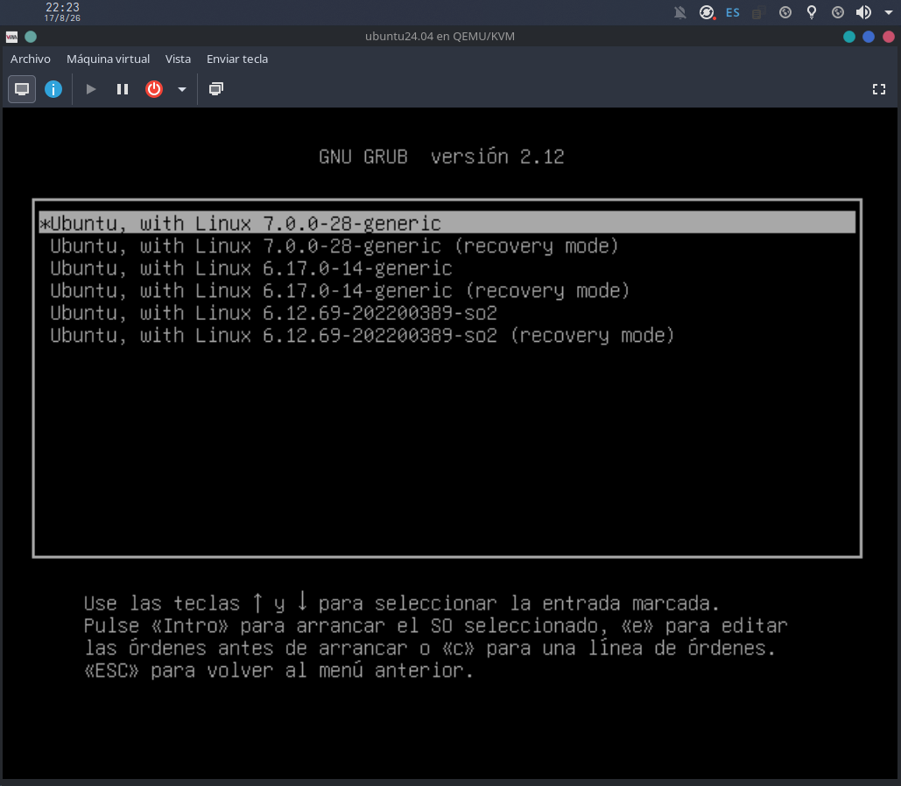
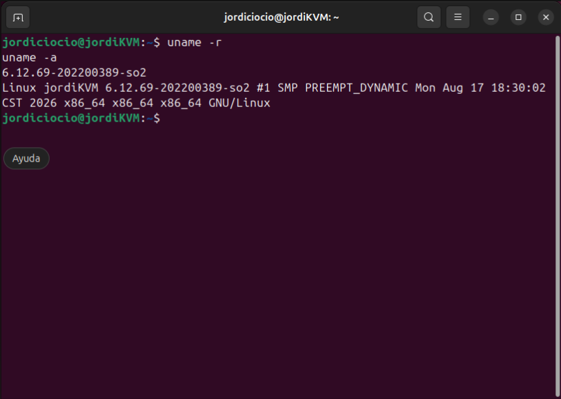
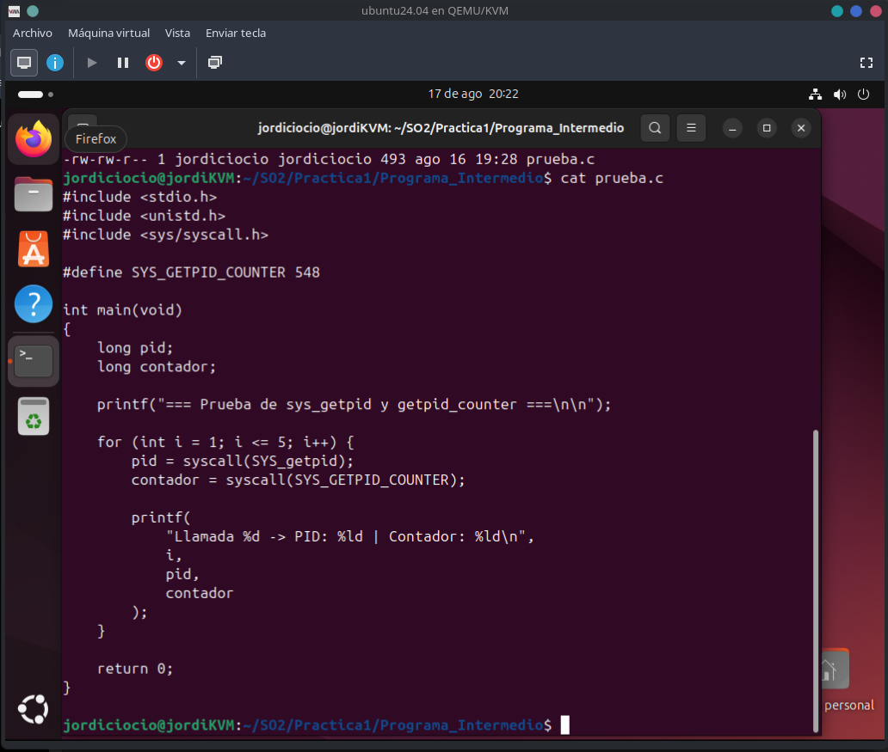
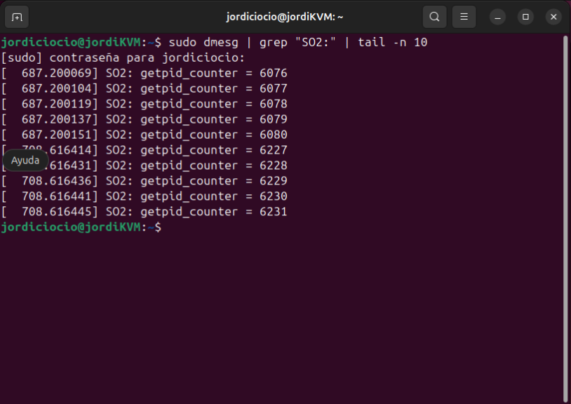

# Informe Técnico
## Práctica 1 - Modificación de funciones del Kernel

**Curso:** Sistemas Operativos 2  
**Carné:** 202200389  
**Kernel base:** Linux 6.12.69  
**Kernel modificado:** Linux 6.12.69-202200389-so2  
**Arquitectura:** x86_64  

---

# 1. Introducción y objetivos

## 1.1 Introducción

La presente práctica tuvo como finalidad trabajar directamente con el código fuente del kernel de Linux para comprender el funcionamiento de las llamadas al sistema y la interacción entre el espacio de usuario y el espacio del kernel.

Para el desarrollo se utilizó el código fuente de Linux 6.12.69 dentro de una máquina virtual con Ubuntu 24.04. La virtualización se realizó utilizando QEMU/KVM sobre un sistema anfitrión Fedora Linux.

La modificación principal consistió en agregar un contador global dentro de la llamada al sistema `getpid()`. Cada vez que un proceso utiliza dicha syscall, el contador incrementa su valor.

Adicionalmente se implementó una nueva llamada al sistema denominada `getpid_counter()`, encargada de consultar el valor actual del contador, imprimirlo en los registros del kernel mediante `printk()` y devolverlo al proceso que realizó la llamada.

Después de modificar el código fuente se realizó la configuración, compilación e instalación del nuevo kernel. Finalmente se desarrolló un programa en lenguaje C para comprobar el funcionamiento de las modificaciones realizadas.

## 1.2 Objetivo general

Modificar el kernel Linux 6.12.69 para registrar la cantidad de llamadas realizadas a `getpid()` e implementar una nueva syscall que permita consultar dicho contador desde espacio de usuario.

## 1.3 Objetivos específicos

- Identificar los archivos relacionados con la implementación y registro de llamadas al sistema.
- Modificar la syscall `getpid()` sin alterar su funcionamiento original.
- Implementar un contador global para registrar las llamadas realizadas a `getpid()`.
- Crear una nueva syscall denominada `getpid_counter()`.
- Registrar la nueva syscall en la tabla correspondiente a la arquitectura x86_64.
- Utilizar `printk()` para registrar información dentro del kernel.
- Compilar e instalar el kernel modificado.
- Desarrollar un programa en C para realizar las pruebas.
- Validar los resultados mediante el comando `dmesg`.

---

# 2. Entorno de trabajo

La práctica fue realizada dentro de una máquina virtual para evitar modificar directamente el kernel del sistema operativo anfitrión.

| Elemento | Configuración |
|---|---|
| Sistema anfitrión | Fedora Linux |
| Virtualización | QEMU/KVM |
| Sistema invitado | Ubuntu 24.04 LTS |
| Arquitectura | x86_64 |
| Kernel fuente | Linux 6.12.69 |
| Kernel personalizado | 6.12.69-202200389-so2 |
| Lenguaje de prueba | C |
| Compilador | GCC |

El código fuente utilizado se encontraba en:

```text
~/SO2/Practica1/linux-6.12.69
```

---

# 3. Guía paso a paso de los archivos modificados

Para implementar la nueva funcionalidad fue necesario modificar tres archivos del código fuente del kernel.

La estructura utilizada fue:

```text
linux 6.12.69/
├── arch/
│   └── x86/
│       └── entry/
│           └── syscalls/
│               └── syscall_64.tbl
├── include/
│   └── linux/
│       └── syscalls.h
└── kernel/
    └── sys.c
```

## 3.1 Modificación de `kernel/sys.c`

El primer archivo modificado fue:

```text
kernel/sys.c
```

En este archivo se encuentra implementada la llamada al sistema `getpid()`.

Su funcionamiento original consistía principalmente en obtener y devolver el identificador del proceso actual:

```c
SYSCALL_DEFINE0(getpid)
{
    return task_tgid_vnr(current);
}
```

Para registrar la cantidad de llamadas realizadas se agregó un contador global atómico:

```c
static atomic64_t getpid_call_counter = ATOMIC64_INIT(0);
```

Posteriormente se modificó `getpid()`:

```c
SYSCALL_DEFINE0(getpid)
{
    atomic64_inc(&getpid_call_counter);

    return task_tgid_vnr(current);
}
```

La instrucción:

```c
atomic64_inc(&getpid_call_counter);
```

incrementa el contador cada vez que se ejecuta `getpid()`.

Después del incremento se mantiene el comportamiento original:

```c
return task_tgid_vnr(current);
```

Por esta razón, la modificación no impide que los programas continúen recibiendo normalmente su PID.

### Evidencia de la modificación



---

## 3.2 Implementación de `getpid_counter()`

Dentro del mismo archivo `kernel/sys.c` se creó la nueva llamada al sistema:

```c
SYSCALL_DEFINE0(getpid_counter)
{
    long count = (long)atomic64_read(&getpid_call_counter);

    printk(KERN_INFO "SO2: getpid_counter = %ld\n", count);

    return count;
}
```

La syscall realiza tres operaciones principales.

Primero obtiene el valor actual del contador:

```c
atomic64_read(&getpid_call_counter);
```

Posteriormente escribe el valor dentro de los mensajes del kernel:

```c
printk(KERN_INFO "SO2: getpid_counter = %ld\n", count);
```

Finalmente devuelve el valor hacia el programa en espacio de usuario:

```c
return count;
```

El funcionamiento general puede representarse de la siguiente manera:

```text
Programa de usuario
        |
        v
      getpid()
        |
        v
Incrementar contador
        |
        v
getpid_counter()
        |
        +----> Leer contador
        |
        +----> printk()
        |
        v
Retornar valor al usuario
```

---

## 3.3 Modificación de `include/linux/syscalls.h`

El segundo archivo modificado fue:

```text
include/linux/syscalls.h
```

En este archivo se agregó la declaración de la nueva llamada al sistema:

```c
asmlinkage long sys_getpid_counter(void);
```

Esta declaración permite que la syscall sea reconocida correctamente durante la construcción del kernel.

---

## 3.4 Modificación de `arch/x86/entry/syscalls/syscall_64.tbl`

El tercer archivo modificado fue:

```text
arch/x86/entry/syscalls/syscall_64.tbl
```

En esta tabla se registró la nueva syscall utilizando el número `548`:

```text
548    common    getpid_counter    sys_getpid_counter
```

Por lo tanto, desde espacio de usuario la nueva llamada puede ser invocada utilizando el número:

```text
548
```

Para comprobar las modificaciones se ejecutó:

```bash
grep -n "getpid_counter" \
kernel/sys.c \
include/linux/syscalls.h \
arch/x86/entry/syscalls/syscall_64.tbl
```

El resultado confirmó la presencia de la implementación, la declaración y el registro de la nueva syscall.

### Evidencia



---

# 4. Configuración del kernel

Antes de realizar la compilación se preparó la configuración correspondiente a Linux 6.12.69.

Se utilizó:

```bash
make olddefconfig
```

Posteriormente se ejecutó:

```bash
make menuconfig
```

para revisar las diferentes opciones disponibles dentro de la configuración del kernel.

## 4.1 Evidencia de `menuconfig`



También se revisó la sección correspondiente al soporte de módulos:



Para identificar fácilmente el kernel desarrollado durante la práctica se configuró:

```text
CONFIG_LOCALVERSION="-202200389-so2"
```

La versión resultante fue:

```text
6.12.69-202200389-so2
```

Durante el proceso también se deshabilitaron opciones de información de depuración que no eran necesarias para la práctica, permitiendo reducir el uso de memoria y espacio en disco durante la compilación.

---

# 5. Proceso de compilación

Antes de iniciar la compilación completa se comprobó que el archivo modificado `kernel/sys.c` compilara correctamente.

Se utilizó:

```bash
make -j1 kernel/sys.o
```

Posteriormente se realizó la compilación completa mediante:

```bash
make -j1
```

La salida también fue almacenada en un archivo de registro utilizando:

```bash
make -j1 2>&1 | tee ~/SO2/Practica1/compilacion-kernel.log
```

Durante la compilación pueden observarse diferentes operaciones como:

```text
CC
LD
CC [M]
LD [M]
```

Estas corresponden a la compilación y enlazado de diferentes componentes y módulos del kernel.

## 5.1 Evidencia del proceso de compilación



Una vez finalizada la compilación se verificó la generación de los principales artefactos mediante:

```bash
ls -lh arch/x86/boot/bzImage vmlinux
```

Se comprobó la existencia de:

```text
arch/x86/boot/bzImage
vmlinux
```

También se verificó la versión compilada ejecutando:

```bash
make kernelrelease
```

El resultado fue:

```text
6.12.69-202200389-so2
```

### Evidencia de los archivos generados


Durante las primeras compilaciones se presentaron problemas por el alto consumo de memoria y espacio en disco. Parte de este consumo estaba relacionado con opciones de depuración y generación de información BTF.

Para reducir los recursos necesarios se deshabilitaron opciones de depuración que no eran requeridas para la práctica, permitiendo posteriormente completar la compilación de manera correcta.

---

# 6. Instalación del kernel

Después de finalizar la compilación se instalaron los módulos utilizando:

```bash
sudo make modules_install
```

Los módulos correspondientes al nuevo kernel fueron instalados en:

```text
/lib/modules/6.12.69-202200389-so2
```

### Evidencia



Posteriormente se instaló el kernel compilado y se generó la imagen necesaria para el arranque.

También se generó el `initramfs` mediante:

```bash
sudo update-initramfs -c -k 6.12.69-202200389-so2
```

Finalmente se actualizó la configuración de GRUB:

```bash
sudo update-grub
```

Después de reiniciar la máquina virtual fue posible seleccionar el kernel personalizado desde el menú de GRUB.

### Evidencia del menú de arranque



---

# 7. Verificación del kernel modificado

Después de iniciar Ubuntu con el nuevo kernel se ejecutó:

```bash
uname -r
```

El resultado obtenido fue:

```text
6.12.69-202200389-so2
```

### Evidencia


También se ejecutó:

```bash
uname -a
```

para obtener información completa del kernel que estaba siendo ejecutado.



Estas pruebas permitieron confirmar que el sistema había iniciado correctamente utilizando el kernel modificado y no el kernel original de Ubuntu.

---

# 8. Programa intermedio

Para realizar las pruebas desde espacio de usuario se creó el archivo:

```text
programa_intermedio/prueba.c
```

El programa implementado fue:

```c
#include <stdio.h>
#include <unistd.h>
#include <sys/syscall.h>

#define SYS_GETPID_COUNTER 548

int main(void)
{
    long pid;
    long contador;

    printf("=== Prueba de sys_getpid y getpid_counter ===\n\n");

    for (int i = 1; i <= 5; i++) {
        pid = syscall(SYS_getpid);
        contador = syscall(SYS_GETPID_COUNTER);

        printf(
            "Llamada %d -> PID: %ld | Contador: %ld\n",
            i,
            pid,
            contador
        );
    }

    return 0;
}
```

### Evidencia del programa



El archivo fue compilado utilizando:

```bash
gcc -Wall -Wextra prueba.c -o prueba
```

Posteriormente fue ejecutado mediante:

```bash
./prueba
```

Durante una de las ejecuciones se obtuvieron los siguientes resultados:

```text
=== Prueba de sys_getpid y getpid_counter ===

Llamada 1 -> PID: 2352 | Contador: 6076
Llamada 2 -> PID: 2352 | Contador: 6077
Llamada 3 -> PID: 2352 | Contador: 6078
Llamada 4 -> PID: 2352 | Contador: 6079
Llamada 5 -> PID: 2352 | Contador: 6080
```

Los resultados muestran que el contador aumentó una unidad después de cada llamada realizada a `getpid()`.

### Evidencia de ejecución


El contador no necesariamente inicia en `1`, ya que `getpid()` también puede ser utilizado por otros procesos y servicios que se encuentran ejecutándose dentro del sistema operativo.

---

# 9. Validación mediante `dmesg`

La syscall `getpid_counter()` utiliza la siguiente instrucción:

```c
printk(KERN_INFO "SO2: getpid_counter = %ld\n", count);
```

Esto permite escribir el valor actual del contador dentro del registro de mensajes del kernel.

Para consultar los mensajes generados se utilizó:

```bash
sudo dmesg | grep "SO2:"
```

Durante la primera ejecución se obtuvieron los siguientes resultados:

```text
SO2: getpid_counter = 6076
SO2: getpid_counter = 6077
SO2: getpid_counter = 6078
SO2: getpid_counter = 6079
SO2: getpid_counter = 6080
```

Posteriormente se ejecutó nuevamente el programa y se observaron valores superiores:

```text
SO2: getpid_counter = 6227
SO2: getpid_counter = 6228
SO2: getpid_counter = 6229
SO2: getpid_counter = 6230
SO2: getpid_counter = 6231
```

Esto demuestra que el contador mantiene su valor mientras el kernel se encuentra en ejecución.

Para visualizar únicamente las últimas entradas se utilizó:

```bash
sudo dmesg | grep "SO2:" | tail -n 10
```

### Evidencia de validación



La salida confirma que `getpid_counter()` ejecuta correctamente `printk()` dentro del espacio kernel y que los mensajes pueden ser consultados posteriormente desde espacio de usuario mediante `dmesg`.

---

# 10. Conclusiones

- Se logró modificar correctamente la llamada al sistema `getpid()` del kernel Linux 6.12.69 sin afectar su comportamiento original.
- El contador global implementado registra correctamente las llamadas realizadas a `getpid()`.
- Se implementó correctamente la nueva syscall `getpid_counter()`.
- La syscall fue registrada con el número `548` dentro de la tabla correspondiente a la arquitectura x86_64.
- Fue posible acceder desde espacio de usuario a información almacenada dentro del kernel.
- `printk()` permitió registrar los valores obtenidos por la nueva syscall dentro de los mensajes del kernel.
- La utilización de `dmesg` permitió comprobar el funcionamiento de la implementación.
- El kernel personalizado fue compilado, instalado y arrancado correctamente con la versión `6.12.69-202200389-so2`.
- El programa desarrollado en C demostró que el contador incrementa correctamente después de cada llamada realizada a `getpid()`.

---

# 11. Lecciones aprendidas

Durante el desarrollo de la práctica se comprendió de forma más clara la organización de las llamadas al sistema dentro del código fuente de Linux y los diferentes archivos involucrados en la implementación de una nueva syscall.

También se aprendió que crear una nueva llamada al sistema no consiste únicamente en escribir una función. Es necesario declarar la syscall, registrar un número dentro de la tabla correspondiente a la arquitectura y posteriormente volver a compilar el kernel.

La práctica también permitió conocer de manera más detallada el proceso de compilación e instalación de un kernel personalizado. Este procedimiento requiere revisar cuidadosamente las configuraciones, dependencias, recursos de memoria y espacio disponible.

Durante las primeras compilaciones se presentaron problemas relacionados con el uso elevado de memoria y espacio en disco. Esto permitió comprender la importancia de revisar las opciones de depuración y adaptar la configuración del kernel a los recursos disponibles en la máquina virtual.

También se aprendió la importancia de conservar un kernel funcional anterior dentro de GRUB, ya que permite recuperar el sistema en caso de que una versión personalizada no pueda iniciar correctamente.

Finalmente, mediante el programa desarrollado en C fue posible observar de manera práctica la comunicación entre espacio de usuario y espacio kernel, mientras que `printk()` y `dmesg` permitieron comprobar internamente la ejecución de la nueva llamada al sistema.
