# Informe Técnico - Práctica 3

## Sincronización e Instrumentación: Comunicación entre Procesos y Monitoreo de Eventos

**Curso:** Sistemas Operativos 2  
**Carné:** 202200389  
**Kernel:** Linux 6.12.69  
**Kernel personalizado:** `6.12.69-202200389-so2-p3`

---

## 1. Introducción

En esta práctica se modificó el kernel Linux 6.12.69 para implementar dos mecanismos relacionados con sincronización e instrumentación.

El primero consiste en un canal de comunicación entre procesos basado en una cola FIFO compartida. Un proceso puede enviar mensajes al kernel y otro proceso puede recibirlos. Cuando no existe información disponible, el receptor queda bloqueado sin utilizar polling y es despertado únicamente cuando un nuevo mensaje llega a la cola.

El segundo mecanismo consiste en un sistema de monitoreo de archivos de log. Un proceso de usuario inicia el monitoreo indicando una lista de archivos, una palabra clave y un archivo de log central. El kernel crea un hilo independiente que revisa periódicamente los archivos y registra las coincidencias detectadas. Otro programa de usuario permite detener el monitor de forma segura.

La práctica permitió trabajar con llamadas al sistema, sincronización, memoria del kernel, wait queues, mutex, hilos de kernel, intercambio de datos entre user space y kernel space y acceso a archivos desde el kernel.

## 2. Objetivos

### 2.1 Objetivo general

Diseñar e implementar mecanismos de comunicación y monitoreo dentro del kernel Linux 6.12.69, aplicando sincronización y ejecución concurrente de manera segura.

### 2.2 Objetivos específicos

- Implementar una syscall para enviar mensajes desde user space hacia una cola FIFO del kernel.
- Implementar una syscall receptora que quede bloqueada sin polling hasta que exista un mensaje.
- Proteger los recursos compartidos mediante mutex.
- Implementar un monitor de archivos mediante un hilo independiente del kernel.
- Permitir iniciar y detener monitores mediante llamadas al sistema.
- Utilizar `copy_from_user()` y `copy_to_user()` para el intercambio de información.
- Validar el funcionamiento mediante programas de usuario y `dmesg`.
- Analizar y corregir errores encontrados durante el desarrollo.

## 3. Entorno utilizado

La práctica fue desarrollada en una máquina virtual Ubuntu ejecutada mediante QEMU/KVM.

Kernel base:

```text
Linux 6.12.69
```

Se configuró:

```text
CONFIG_LOCALVERSION="-202200389-so2-p3"
```

Resultado:

```text
6.12.69-202200389-so2-p3
```

La compilación se realizó con:

```bash
make -j1
```

## 4. Archivos modificados en el kernel

### 4.1 `arch/x86/entry/syscalls/syscall_64.tbl`

Se registraron:

```text
548  common  ipc_channel_send      sys_ipc_channel_send
549  common  ipc_channel_receive   sys_ipc_channel_receive
550  common  start_log_watch       sys_start_log_watch
551  common  stop_log_watch        sys_stop_log_watch
```

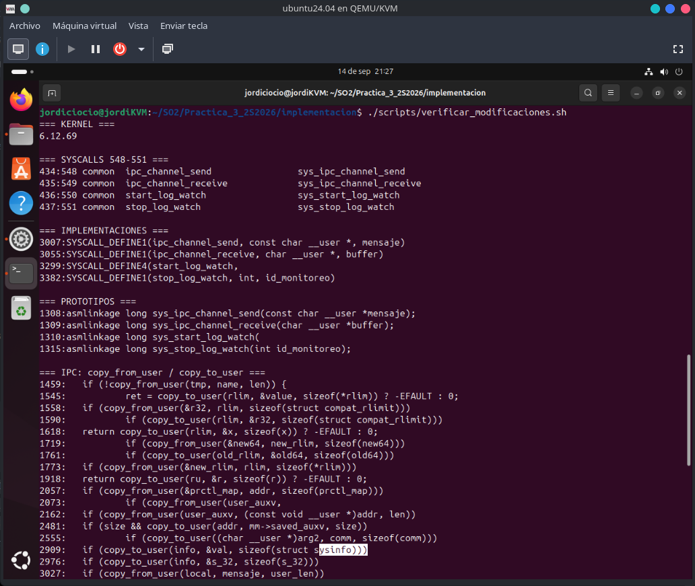

### 4.2 `include/linux/syscalls.h`

Se agregaron los prototipos de las cuatro llamadas al sistema.

### 4.3 `kernel/sys.c`

En este archivo se implementaron:

- cola FIFO circular;
- mutex del canal IPC;
- wait queue;
- `ipc_channel_send`;
- `ipc_channel_receive`;
- estructuras para monitores de log;
- lista de monitores activos;
- mutex para la lista;
- hilo de kernel de monitoreo;
- lectura periódica de archivos;
- detección de palabra clave;
- escritura en log central;
- inicio y detención segura;
- validaciones adicionales encontradas durante las pruebas.

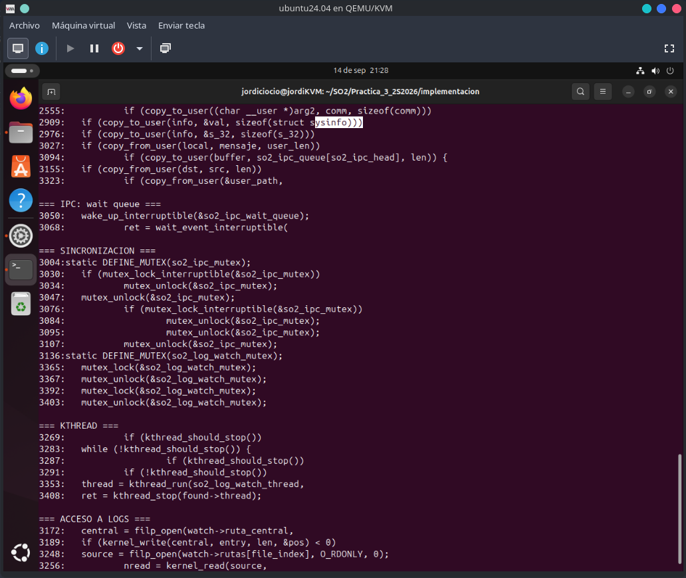

## 5. Mecanismo de sincronización del canal IPC

El canal utiliza una cola FIFO circular con capacidad limitada. La cola mantiene posiciones de lectura y escritura, cantidad de mensajes y longitud de cada elemento.

Para proteger la estructura compartida se utiliza:

```c
DEFINE_MUTEX(so2_ipc_mutex);
```

Se eligió un mutex porque las operaciones pueden dormir y no existe necesidad de utilizar espera activa mediante spinlock.

Para evitar polling se utiliza una wait queue:

```c
DECLARE_WAIT_QUEUE_HEAD(so2_ipc_wait_queue);
```

El receptor espera con:

```c
wait_event_interruptible(
    so2_ipc_wait_queue,
    READ_ONCE(so2_ipc_count) > 0
);
```

Cuando un emisor agrega un mensaje ejecuta:

```c
wake_up_interruptible(&so2_ipc_wait_queue);
```

Flujo:

```text
receptor
   |
   +--> cola vacía
           |
           +--> wait_event_interruptible()
                    |
                    +--> proceso dormido
                             |
emisor                        |
   |                          |
   +--> agrega mensaje        |
   +--> wake_up_interruptible()
                             |
                             +--> receptor despierta
                                      |
                                      +--> copy_to_user()
```


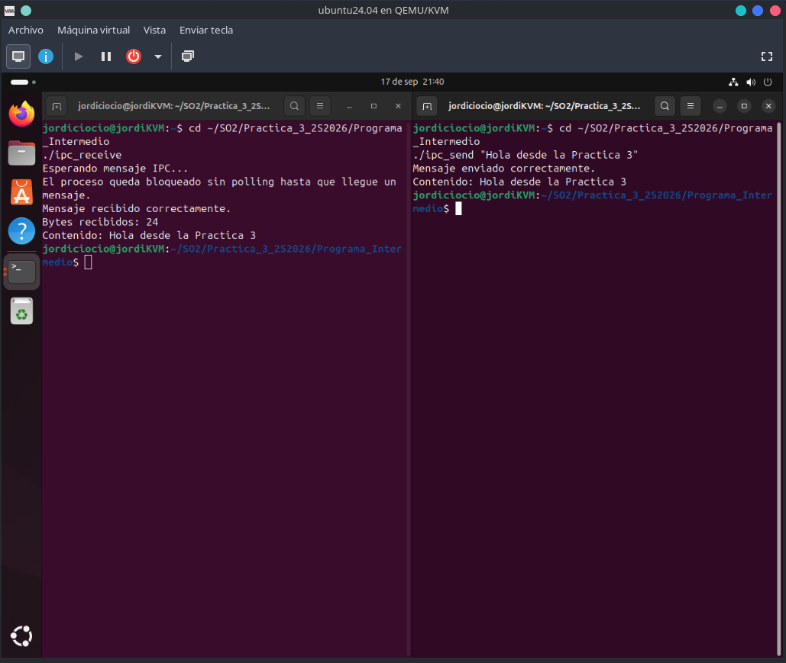

## 6. Comunicación entre user space y kernel space

Los punteros de usuario no se acceden directamente.

Para recibir datos se utiliza `copy_from_user()` y para entregar el mensaje al receptor se utiliza `copy_to_user()`.

En `start_log_watch` también se copian las rutas y la palabra clave a memoria controlada por el kernel.

## 7. Ciclo de vida del hilo `log_watch`

### 7.1 Creación

`start_log_watch` recibe rutas, cantidad, ruta central y palabra clave. Después de validar los parámetros se crea una estructura `so2_log_watch`, se asigna un ID y se crea el hilo mediante:

```c
kthread_run(
    so2_log_watch_thread,
    watch,
    "so2_log_watch/%d",
    watch->id
);
```

La estructura se agrega a una lista global protegida mediante mutex.

### 7.2 Ejecución periódica

El hilo se ejecuta mientras `kthread_should_stop()` sea falso.

En cada ciclo:

1. recorre los archivos vigilados;
2. abre cada archivo;
3. lee desde la última posición conocida;
4. reconstruye líneas;
5. busca la palabra clave;
6. escribe coincidencias en el log central;
7. duerme antes de repetir.

Cada archivo mantiene su propia posición de lectura para evitar procesar repetidamente contenido antiguo.

### 7.3 Registro de coincidencias

El log central contiene:

- ID del monitor;
- archivo de origen;
- palabra clave;
- línea detectada.

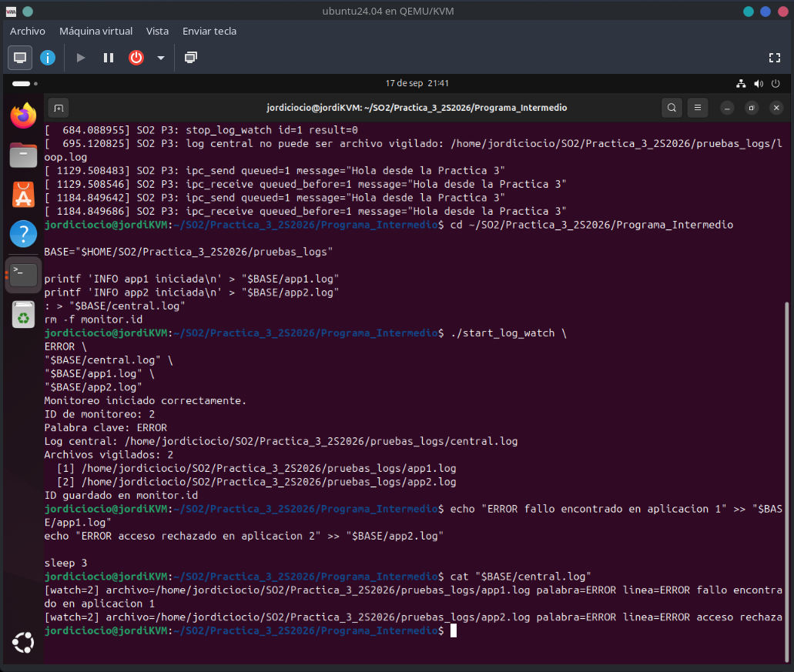

### 7.4 Terminación segura

`stop_log_watch` recibe el ID, busca el monitor en la lista, lo retira bajo protección del mutex, ejecuta `kthread_stop()` y libera la memoria cuando el hilo ya terminó.

## 8. Configuración y compilación

Se reutilizó una configuración funcional de Linux 6.12.69 y se cambió el `LOCALVERSION`.

Se ejecutó:

```bash
make olddefconfig
make menuconfig
make prepare
```

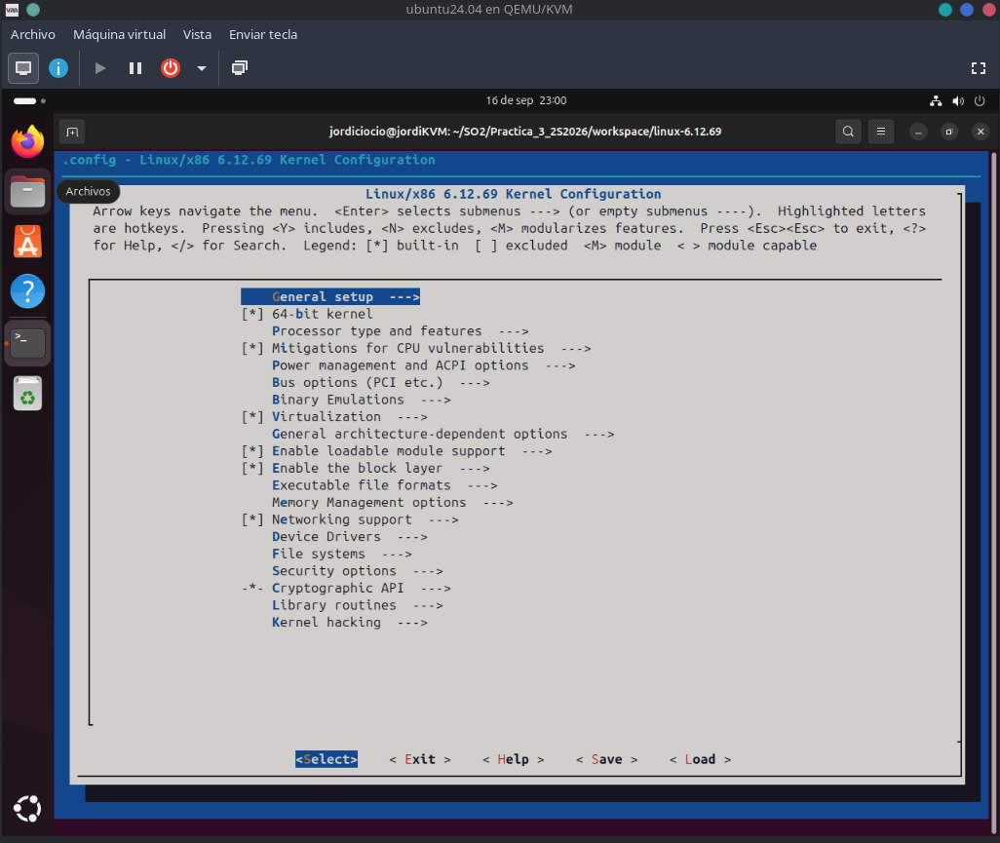

Antes de compilar todo se validó:

```bash
make -j1 kernel/sys.o
```

Luego:

```bash
make -j1
```

Se generaron correctamente `bzImage`, `vmlinux` y `System.map`.

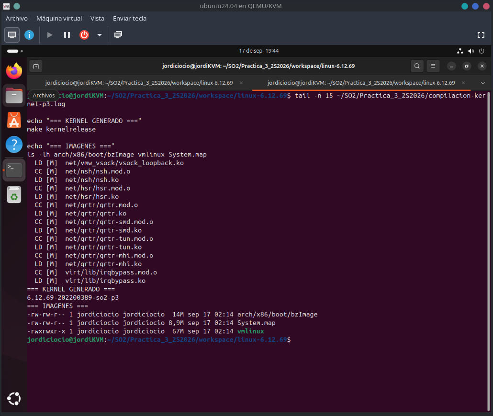

## 9. Instalación y arranque

Se ejecutó:

```bash
sudo make modules_install
sudo make install
sudo update-initramfs -u -k 6.12.69-202200389-so2-p3
sudo update-grub
```

GRUB detectó el kernel:

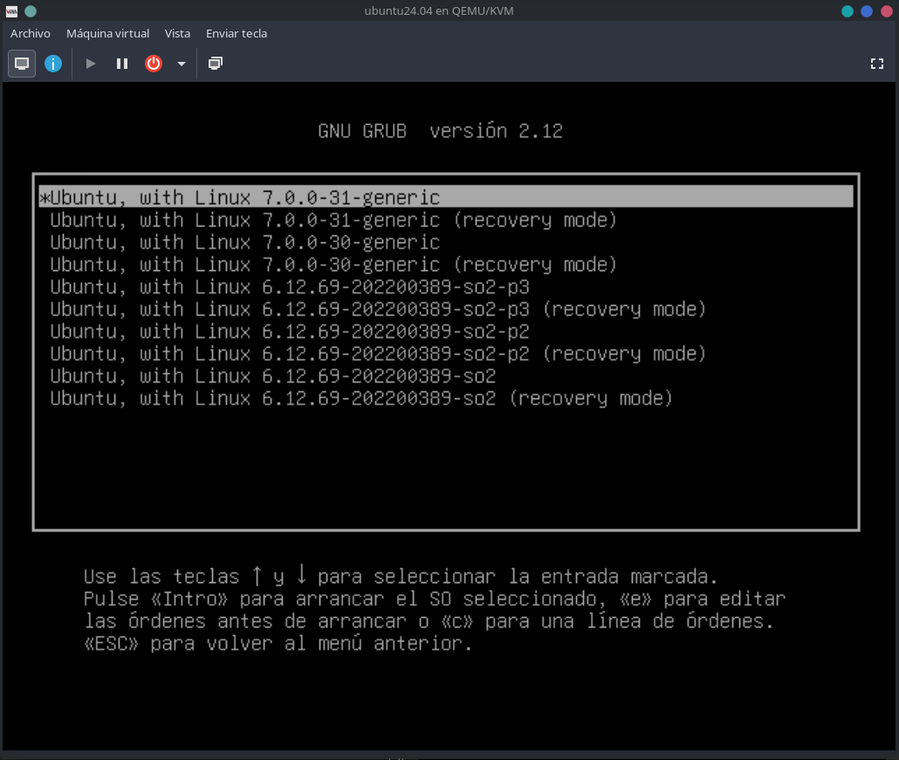

Luego se comprobó:

```bash
uname -r
```

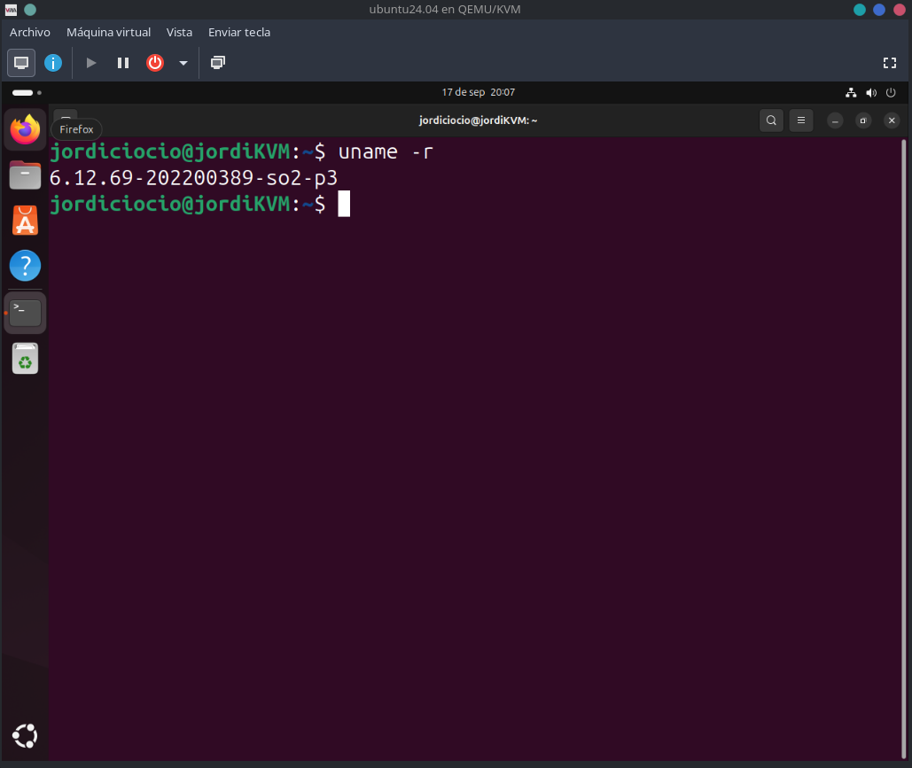

## 10. Pruebas funcionales

### 10.1 IPC bloqueante

Se ejecutó primero:

```bash
./ipc_receive
```

El proceso quedó bloqueado. En otra terminal:

```bash
./ipc_send "Hola desde la Practica 3"
```

El receptor despertó y recibió el mensaje.


### 10.2 Monitor de dos logs

Se iniciaron dos archivos de prueba y se generaron eventos con la palabra `ERROR`. Ambas coincidencias fueron registradas en el log central.


### 10.3 Verificación con `dmesg`

```bash
sudo dmesg | grep "SO2 P3:"
```

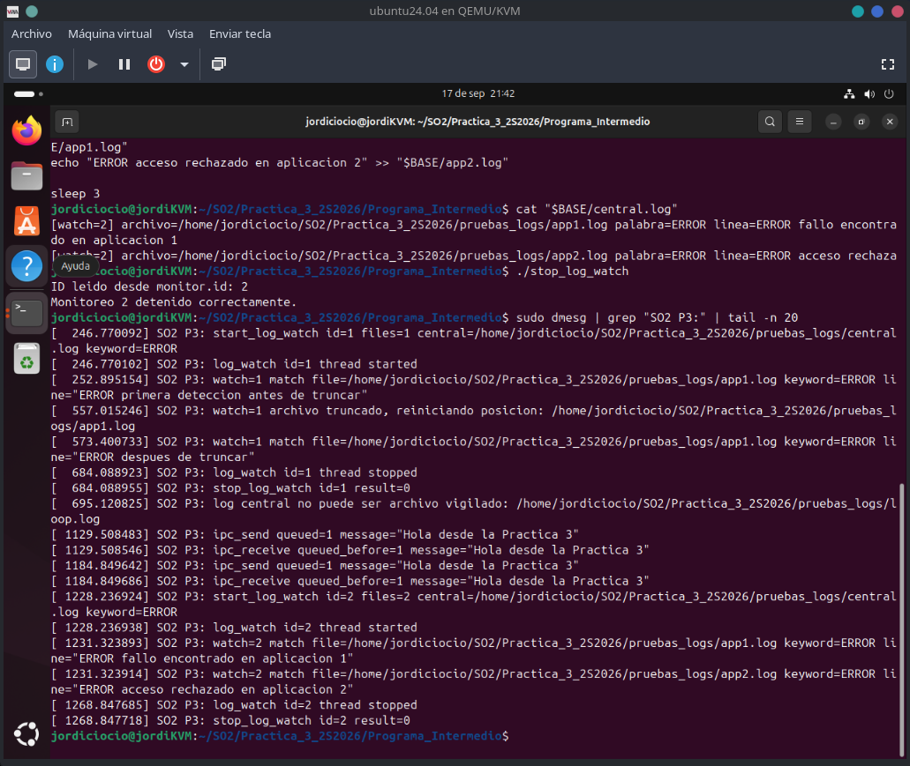

## 11. Errores encontrados y corregidos

La descripción completa se encuentra en [ERRORES.md](ERRORES.md).

### Error 1 - Uso excesivo de pila del kernel

Buffers locales generaban frames de 1472 y 1072 bytes. Se movieron a memoria dinámica mediante `kmalloc()` y `kfree()`.

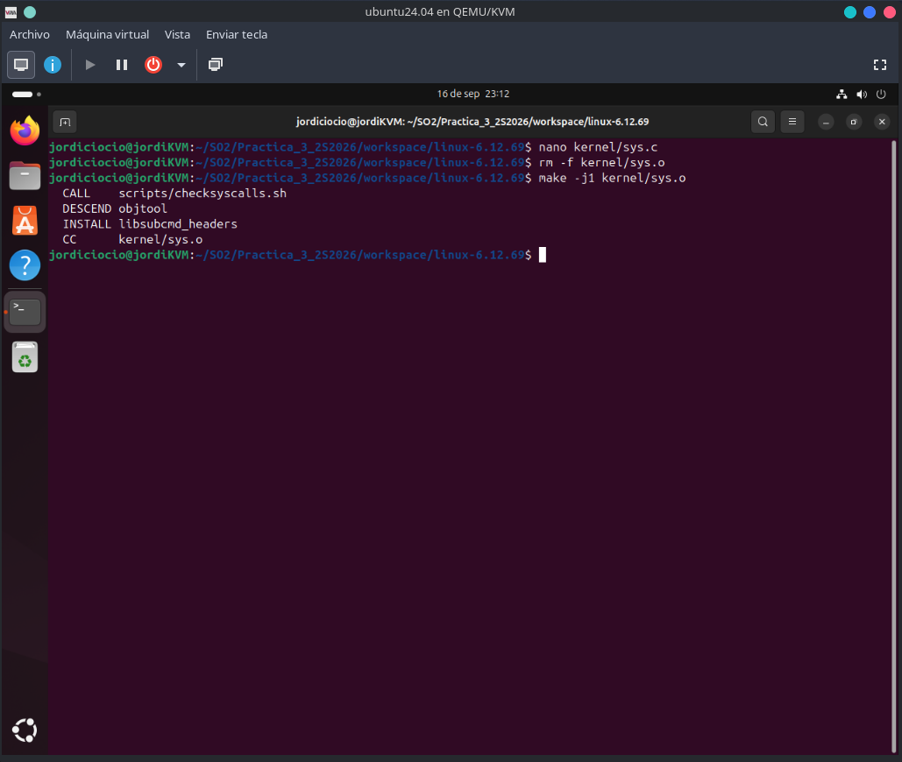

### Error 2 - Truncamiento de archivos de log

Después de truncar un archivo, la posición de lectura permanecía más allá del nuevo EOF.

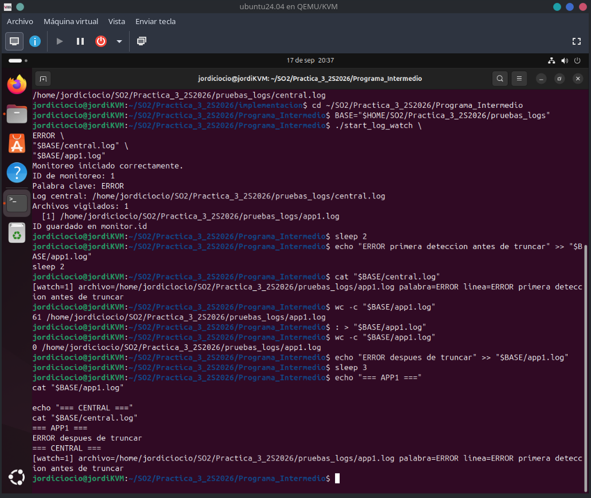

Se agregó una comprobación del tamaño actual del archivo y se reinicia la posición cuando corresponde.

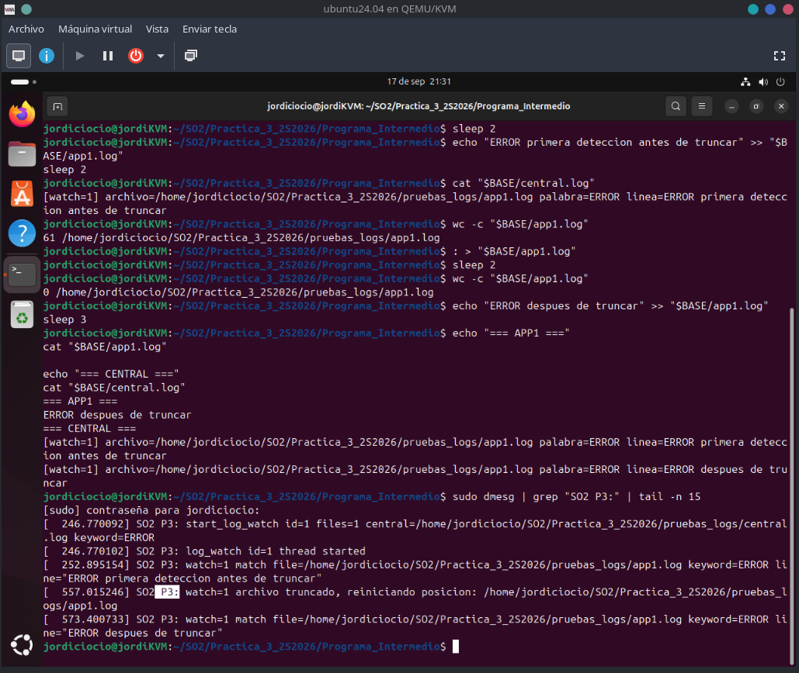

### Error 3 - Auto monitoreo del log central

La implementación permitía usar el mismo archivo como log central y vigilado.

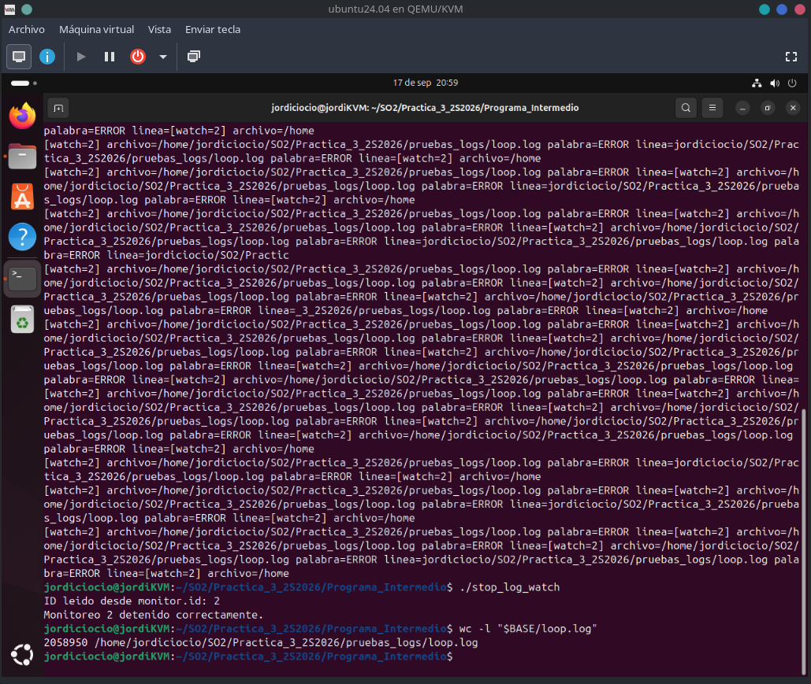

Se agregó una validación que rechaza esta configuración con `-EINVAL`.

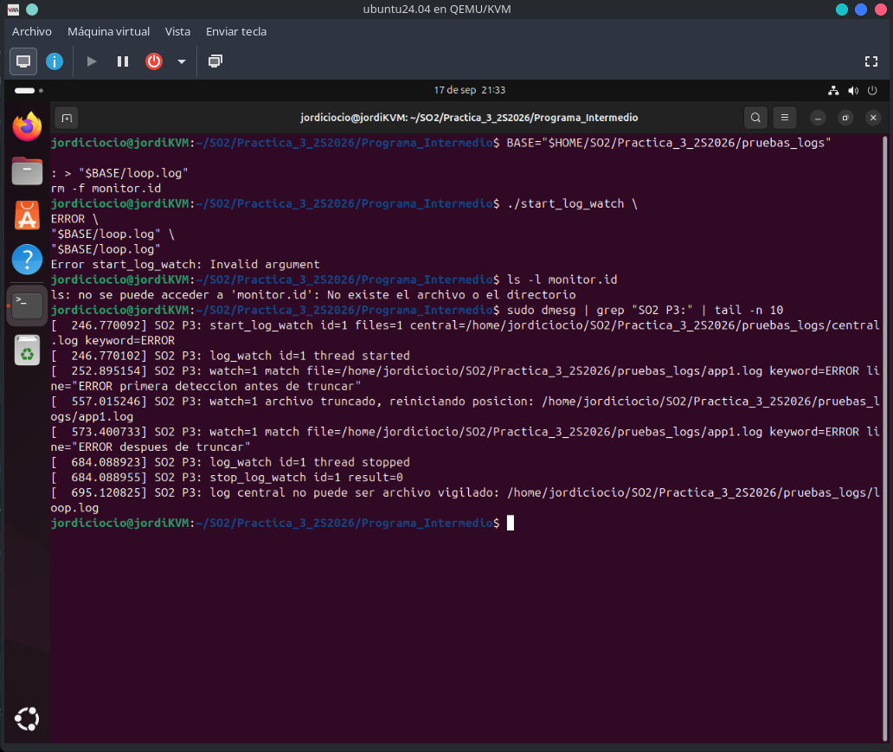

## 12. Conclusiones

1. Las wait queues permiten bloquear procesos sin consumir CPU mediante espera activa.
2. Los mutex permiten proteger estructuras compartidas ante accesos concurrentes.
3. La comunicación entre user space y kernel space debe utilizar helpers seguros como `copy_from_user()` y `copy_to_user()`.
4. Los kthreads permiten ejecutar tareas autónomas en segundo plano dentro del kernel.
5. Un monitor de logs debe considerar no solo crecimiento normal, sino truncamientos y configuraciones inválidas.
6. Compilar primero el archivo modificado reduce el tiempo necesario para detectar errores antes de recompilar todo el kernel.

## 13. Lecciones aprendidas

La práctica permitió comprender que la concurrencia requiere controlar tanto el acceso a datos compartidos como el momento en que un proceso debe dormir o despertar.

También se comprobó que el desarrollo en kernel requiere más cuidado con memoria y recursos. Un ejemplo fue el uso de buffers grandes en la pila, que fue sustituido por asignación dinámica.

Las pruebas de casos no ideales permitieron descubrir problemas que no aparecían durante la ejecución normal, especialmente truncamiento de logs y auto monitoreo.

## 14. Archivos entregados

Kernel:

```text
linux 6.12.69/kernel/sys.c
linux 6.12.69/include/linux/syscalls.h
linux 6.12.69/arch/x86/entry/syscalls/syscall_64.tbl
```

Programas:

```text
Programa_Intermedio/ipc_send.c
Programa_Intermedio/ipc_receive.c
Programa_Intermedio/start_log_watch.c
Programa_Intermedio/stop_log_watch.c
```
