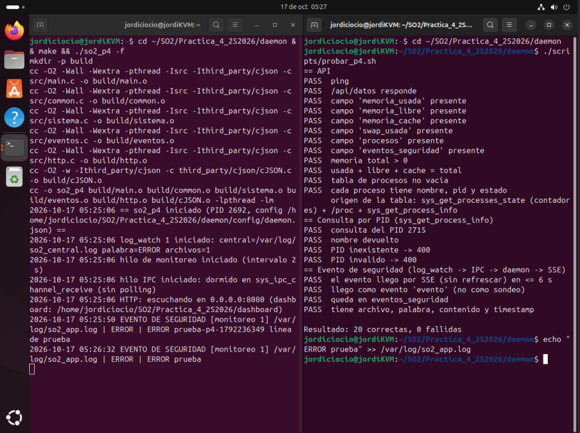
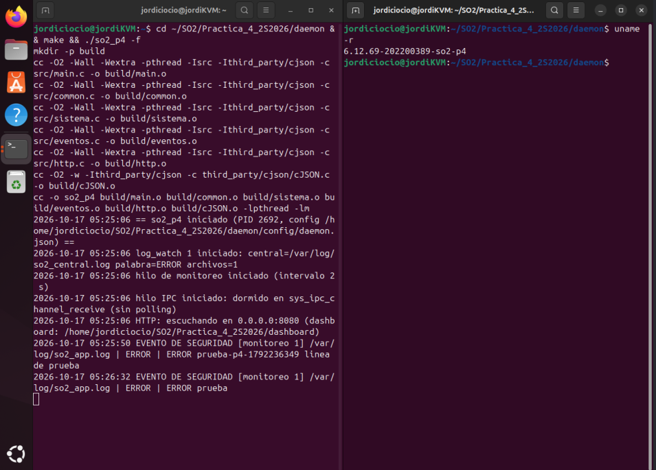
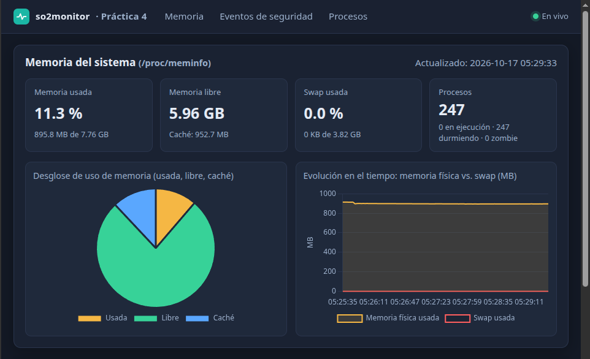
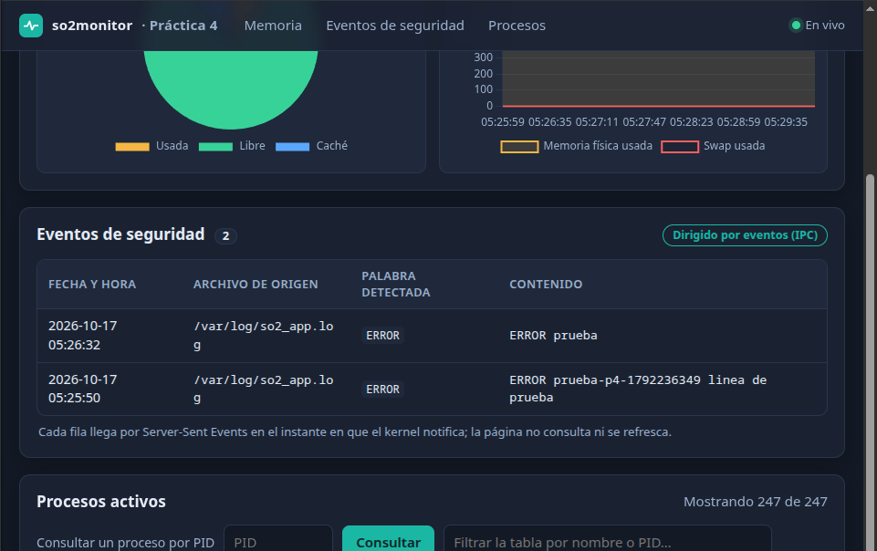
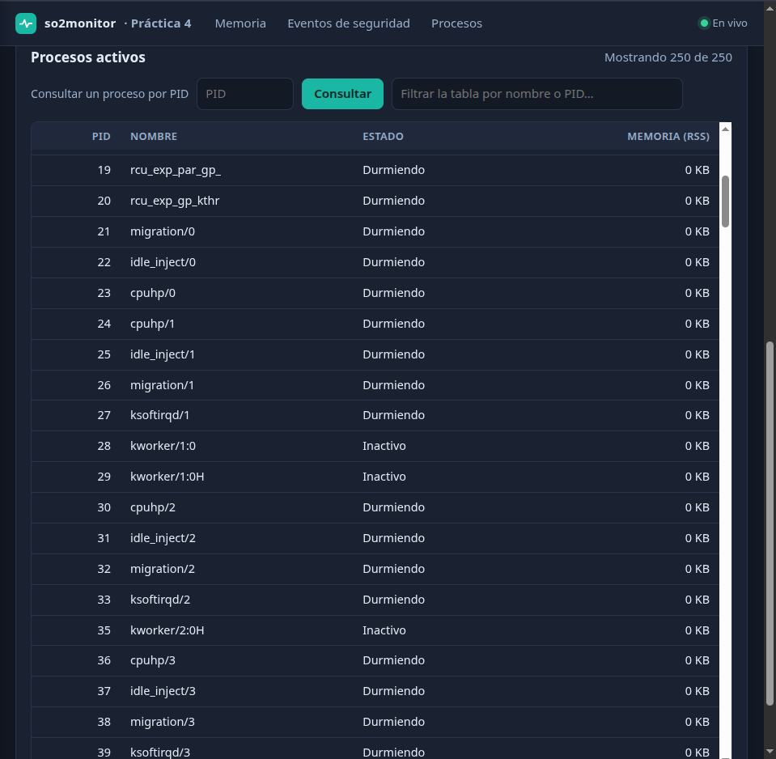
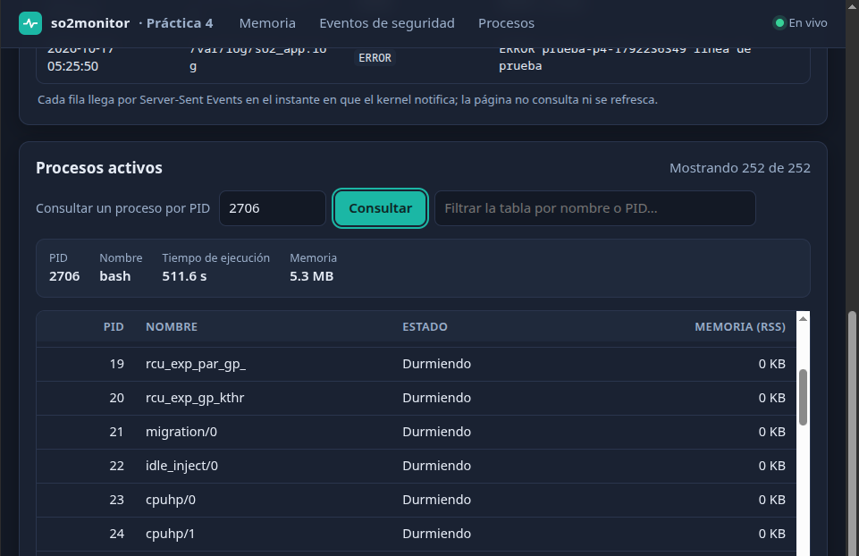

# Práctica 4 — Daemon y Dashboard

Carné 202200389 · Kernel Linux 6.12.69 (`6.12.69-202200389-so2-p4`)

Este documento describe la capa de usuario de la Práctica 4: el **daemon en C** que orquesta
las syscalls de las prácticas 2 y 3 y el **dashboard web** que muestra todo en tiempo real.
El kernel (syscalls 548–553) está en `linux 6.12.69/` y no cambia.

## 1. Arquitectura

```text
  ┌────────────────────────────── Máquina virtual ──────────────────────────────┐
  │  KERNEL (6.12.69-202200389-so2-p4)                                          │
  │   548 get_process_info   549 get_processes_state                            │
  │   552/553 start/stop_log_watch ──(kthread vigila los logs)                  │
  │        │ coincidencia de palabra clave                                       │
  │        ▼  cola IPC del kernel (550/551)                                      │
  │  DAEMON so2_p4 (C, 3+ hilos)                                                 │
  │   hilo sistema : /proc/meminfo + tabla de procesos  (sondeo periódico, 2 s)  │
  │   hilo IPC     : DORMIDO en sys_ipc_channel_receive (sin sondeo)             │
  │   hilo HTTP    : API JSON + Server-Sent Events + archivos del dashboard      │
  └──────────────────────────────────┬───────────────────────────────────────────┘
                                     │ HTTP / SSE (JSON)
                          ┌──────────▼──────────┐
                          │  DASHBOARD (host)   │  navegador
                          └─────────────────────┘
```

## 2. Rol de cada syscall

| Syscall | Rol dentro del sistema |
|---|---|
| `548 sys_get_process_info(pid)` | Alimenta el campo **consulta por PID** (nombre, tiempo de ejecución, memoria) y, cuando la lista no la entrega la 549, el nombre y la memoria de cada fila de la tabla. |
| `549 sys_get_processes_state()` | Contadores de procesos (total, en ejecución, durmiendo, zombie) que se muestran en el resumen. En un kernel que además devuelve la lista por proceso, la tabla se alimenta directamente de ella. |
| `552 sys_start_log_watch` | El daemon la invoca **al arrancar** con los parámetros de `config/daemon.json`. |
| `553 sys_stop_log_watch` | El daemon la invoca **al terminar** para cada monitoreo que inició. |
| `550/551 sys_ipc_channel_send/receive` | Canal de notificación. `log_watch` encola en él un mensaje `SECURITY\|ID\|ARCHIVO\|PALABRA\|CONTENIDO` al detectar la palabra; el daemon está bloqueado en la 551. |

## 3. Diseño de la notificación IPC (por qué no hay polling)

Un panel de eventos que consulta cada segundo «¿hay algo nuevo?» gasta CPU en vano y
retrasa el aviso hasta el siguiente ciclo. En lugar de eso:

1. `sys_start_log_watch` crea un hilo del kernel que vigila los archivos. Al encontrar la
   palabra clave llama a `so2_ipc_enqueue_kernel()` (ver `kernel/sys.c`), un *helper* interno que
   mete el mensaje en la cola IPC **sin pasar por `copy_from_user`** (la 550 espera un puntero de
   usuario y `log_watch` corre dentro del kernel).
2. Un hilo dedicado del daemon (`ipc_thread`) llama a `sys_ipc_channel_receive`, que duerme en
   una *wait queue* del kernel (`wait_event_interruptible`). Consume **0 % de CPU** mientras no
   pasa nada y despierta en el instante en que llega el mensaje.
3. Al despertar, el daemon guarda el evento y lo **empuja** al dashboard por SSE (`event: evento`).
   El navegador no pregunta ni se refresca.

Es el patrón productor–consumidor: productor = hilo del kernel de `log_watch`; consumidor = hilo IPC
del daemon. Para apagar el daemon, el hilo bloqueado se interrumpe con una señal (`SIGUSR1`
instalada **sin** `SA_RESTART`, de modo que la syscall devuelve `EINTR`).

El sondeo que sí existe es el permitido por el enunciado: `/proc/meminfo` y el estado de procesos
se consultan cada 2 s (son consultas de estado, no eventos).

## 4. Compatibilidad de kernels

La syscall 549 del kernel de la Práctica 4 recibe **un** argumento y solo devuelve contadores, no
la lista por proceso que necesita la tabla. Sin tocar ese kernel, el daemon la invoca con tres
argumentos (`state`, `buffer`, `max`): el kernel de la P4 ignora los dos últimos y deja `count`
en 0; un kernel que sí devuelve la lista la rellena.

| Situación | Origen de la tabla (campo `fuente_procesos`) |
|---|---|
| La syscall devuelve la lista | `sys_get_processes_state (lista por proceso)` |
| La syscall solo devuelve contadores (kernel P4) | `sys_get_processes_state (contadores) + /proc + sys_get_process_info` |
| Sin syscall (kernel genérico) | `/proc (la syscall no esta disponible)` |

En el segundo caso se recorren los PID de `/proc` y se llama a `sys_get_process_info` por cada uno
para obtener nombre y memoria. El daemon **no se cae** si una syscall falla: registra el error y
sigue con la siguiente fuente.

## 5. Compilar y ejecutar

Requisitos en la VM: `gcc`, `make` (nada más; no usa libbpf, PAM ni OpenSSL).

```bash
cd Practica_4_2S2026/daemon
make                                   # genera ./so2_p4
# (opcional) crear los logs de ejemplo que usa la configuración
sudo touch /var/log/so2_app.log /var/log/so2_central.log && sudo chmod 666 /var/log/so2_app.log
./so2_p4 -f                            # primer plano (el log sale por pantalla)
# o como servicio en segundo plano:  ./so2_p4   (log: /tmp/so2_p4.log, pid: /tmp/so2_p4.pid)
```

Abra el dashboard en `http://IP_DE_LA_VM:8080/` (la IP con `hostname -I`; desde la propia VM,
`http://127.0.0.1:8080/`). Para detener el servicio: `kill $(cat /tmp/so2_p4.pid)` o `Ctrl+C` en
primer plano.

Configuración (`daemon/config/daemon.json`): `port`, `bind`, `intervalo_s`, `dashboard_dir`,
`forzar_proc` y la lista `logwatch` (`central`, `palabra`, `rutas`). Las syscalls no requieren
root; el daemon corre como usuario normal.

### Generar un evento de seguridad

```bash
echo "ERROR acceso rechazado" >> /var/log/so2_app.log
```

En ≤ 1–2 s aparece una fila en «Eventos de seguridad» (el hilo de `log_watch` revisa los
archivos cada segundo; el aviso al navegador es inmediato).

### Prueba automática

```bash
./scripts/probar_p4.sh http://127.0.0.1:8080
```

Comprueba los campos del JSON, la consulta por PID y que un evento llega por SSE.

## 6. Interfaz HTTP (solo lectura)

| Ruta | Respuesta |
|---|---|
| `GET /api/datos` | JSON completo (abajo) |
| `GET /api/proceso?pid=N` | `{pid, nombre, tiempo_ejecucion_s, memoria_kb}` (de `sys_get_process_info`) |
| `GET /api/stream` | SSE: `event: datos` cada intervalo, `event: evento` al instante |
| `GET /api/ping` | `{"ok":true}` |

```json
{
  "memoria_usada": 0, "memoria_libre": 0, "memoria_cache": 0, "swap_usada": 0,
  "procesos": [ {"nombre": "", "pid": 0, "estado": ""} ],
  "eventos_seguridad": [ {"archivo_origen": "", "palabra_detectada": "", "contenido": "", "timestamp": ""} ]
}
```

Unidades en **kB**. `memoria_cache` = `Cached + Buffers`, de modo que usada + libre + caché = total.
El JSON añade campos auxiliares (`memoria_total`, `swap_total`, `resumen_procesos`,
`fuente_procesos`, `historial`).

El servicio **no expone ninguna acción que modifique el sistema** (no hay login, no se pueden
iniciar ni detener monitoreos desde la red): escucha en `0.0.0.0` para que el dashboard pueda
abrirse desde el host, y por eso solo ofrece lectura.

## 7. Dashboard — las 5 visualizaciones

1. **Pie** de memoria (usada, libre, caché).
2. **Líneas**: memoria física vs. swap en el tiempo (MB).
3. **Tabla de procesos** (nombre, PID, estado, RSS) con filtro; viene de la 549.
4. **Panel de eventos de seguridad** en tiempo real (archivo de origen, palabra, contenido, hora).
5. **Consulta por PID**: ingresa un PID y muestra el detalle (`sys_get_process_info`).

Chart.js 4.4.1 (MIT) se incluye en `dashboard/vendor/` en lugar de cargarse de un CDN: la VM puede
no tener internet y así el dashboard funciona sin conexión. Todo texto que viene del sistema
(nombres de proceso, contenido de logs) se inserta con `textContent`, nunca con `innerHTML`.

## 8. Errores encontrados durante la integración

Los tres primeros ocurrieron durante la integración; los dos últimos son problemas que se anticiparon y se resolvieron por diseño (se documentan porque explican decisiones del código).

**Error 1 — Programas de prueba con los números de syscall de la Práctica 3.**
`ipc_send`, `ipc_receive`, `start_log_watch` y `stop_log_watch` conservaban 548–551; en el kernel
integrado esos números son `get_process_info`, `get_processes_state`, `ipc_channel_send` y
`ipc_channel_receive`, así que cada programa llamaba a otra syscall. *Solución:* actualizar los
`#define` a 550, 551, 552 y 553 y comprobar con `grep -n 'define SYS_' *.c`.

**Error 2 — La syscall 549 no entrega la lista por proceso.**
La tabla de procesos necesita nombre, PID y estado de cada proceso, pero `sys_get_processes_state`
del kernel de la P4 solo devuelve cuatro contadores. *Solución:* no modificar el kernel ya
compilado; el daemon obtiene la lista recorriendo `/proc` y completa nombre y memoria con
`sys_get_process_info` por cada PID, e indica el origen en `fuente_procesos`. Si el kernel sí
devuelve la lista, la usa directamente.

**Error 3 — Métricas vacías: «/proc/meminfo con formato inesperado».**
La función genérica de lectura de archivos reservaba el buffer con `st_size`, pero los archivos de
`/proc` reportan tamaño 0, de modo que se leían 0 bytes y todas las claves parecían ausentes.
El daemon se quedaba sin muestras de memoria aunque no fallaba. *Solución:* leer hasta EOF
creciendo el buffer, sin fiarse de `st_size`; se añadió una prueba con `/proc/meminfo`,
`/proc/vmstat`, un archivo mayor que el límite y uno inexistente.

**Problema previsto 4 — Un hilo dormido en el kernel impediría apagar el daemon.**
`sys_ipc_channel_receive` bloquea indefinidamente; un `pthread_join` esperaría para siempre.
*Solución:* instalar un manejador de `SIGUSR1` **sin** `SA_RESTART` y enviarlo al hilo con
`pthread_kill` hasta que termina: la syscall devuelve `EINTR` y el hilo comprueba la bandera de
parada.

**Problema previsto 5 — Un mensaje IPC con `|` en el contenido.**
El mensaje es `SECURITY|ID|ARCHIVO|PALABRA|CONTENIDO` y la línea del log puede contener `|`.
*Solución:* se separan solo los primeros cuatro campos y el resto se toma como contenido; además
se rechazan palabras clave con `|` al iniciar el monitoreo.

## 9. Verificación

### 9.1 Prueba de extremo a extremo en la máquina virtual

`daemon/scripts/probar_p4.sh` se ejecutó contra el daemon real, en la VM, con las syscalls reales:
**20 comprobaciones correctas, 0 fallidas**.



*Izquierda: el daemon compilando con `make` y corriendo en primer plano; su log muestra el hilo IPC
«dormido en sys_ipc_channel_receive (sin polling)» y, más abajo, los dos «EVENTO DE SEGURIDAD»
(el de la prueba automática y el del `echo` manual). Derecha: `probar_p4.sh` con 20 `PASS`.*

La prueba se hizo con el kernel de la Práctica 4 (`uname -r` = `6.12.69-202200389-so2-p4`), con el
daemon corriendo en la otra terminal:



Qué demuestra la captura:

- **Campos del enunciado:** `memoria_usada`, `memoria_libre`, `memoria_cache`, `swap_usada`,
  `procesos` y `eventos_seguridad` están presentes, y usada + libre + caché = total.
- **Tabla de procesos:** cada proceso trae nombre, PID y estado. La línea
  `origen de la tabla: sys_get_processes_state (contadores) + /proc + sys_get_process_info` es la
  ruta de compatibilidad de la sección 4: el kernel de la Práctica 4 solo devuelve contadores y la
  lista se completa con `/proc` y `sys_get_process_info`.
- **Consulta por PID:** `sys_get_process_info` devuelve el proceso pedido (`nombre devuelto`), y los
  PID inexistentes o inválidos responden 400 sin tumbar el daemon.
- **Patrón dirigido por eventos:** el evento llegó por SSE en ≤ 6 s, como evento `evento` (no por
  sondeo), y quedó registrado con archivo de origen, palabra, contenido y fecha.

### 9.2 El dashboard funcionando

Capturas del dashboard conectado al daemon real (indicador «En vivo» arriba a la derecha).

**Memoria (visualizaciones 1 y 2).** Pie con el desglose usada / libre / caché y gráfico de líneas
de memoria física vs. swap en el tiempo; las tarjetas resumen el estado y el número de procesos.



**Eventos de seguridad (visualización 4).** Tabla alimentada por el canal IPC. Las dos filas son
las mismas que registró el log del daemon en la captura anterior (`05:25:50`, generada por
`probar_p4.sh`, y `05:26:32`, generada a mano con `echo`). El contador marca 2 y la nota indica que
la fila llegó por SSE en el instante de la notificación, sin refrescar la página.



**Procesos activos (visualización 3).** Tabla con PID, nombre, estado y memoria (RSS), con filtro
por nombre o PID. Los hilos del kernel (`kworker`, `migration`, `cpuhp`, …) aparecen con 0 KB porque
no tienen espacio de direcciones de usuario; así lo reporta `sys_get_process_info`.



**Consulta por PID (visualización 5).** Al ingresar un PID el dashboard llama a
`/api/proceso`, que invoca `sys_get_process_info`; aquí el PID 2706 corresponde a `bash`, con su
tiempo de ejecución y su memoria.



### 9.3 Otras comprobaciones

- Compila sin avisos (`gcc -Wall -Wextra`).
- En un kernel sin las syscalls (Fedora) el daemon **no se cae**: sirve la memoria y la tabla desde
  `/proc` y avisa una sola vez de las syscalls ausentes.
- El dashboard se renderizó con datos reales y con eventos de prueba; el contenido malicioso
  (``) se muestra como texto y no se ejecuta.
