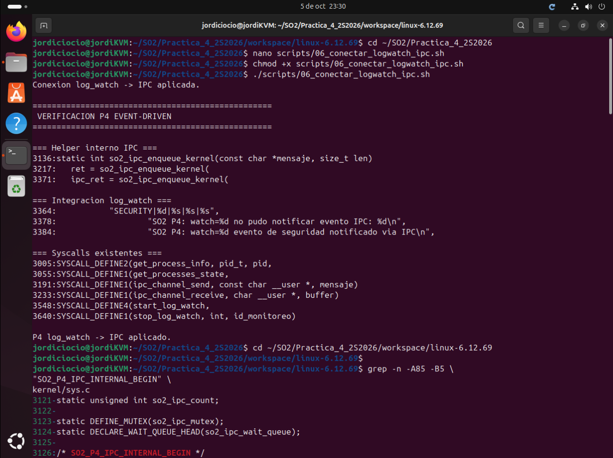
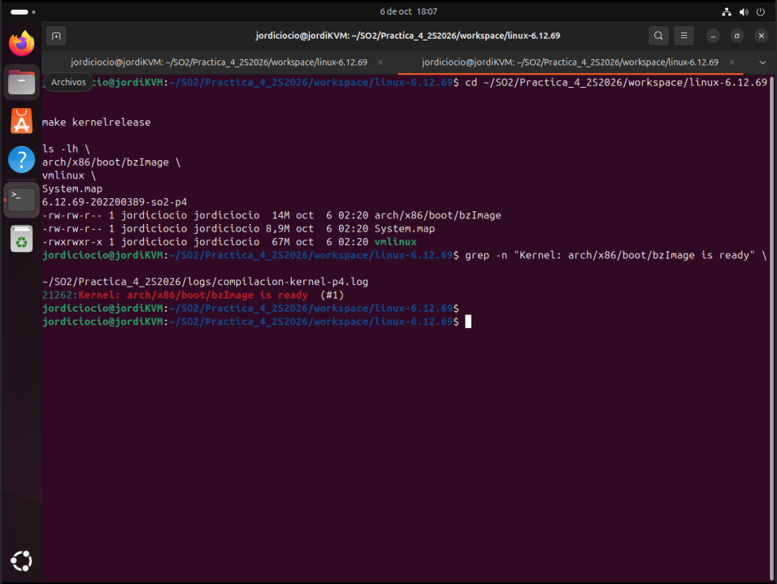
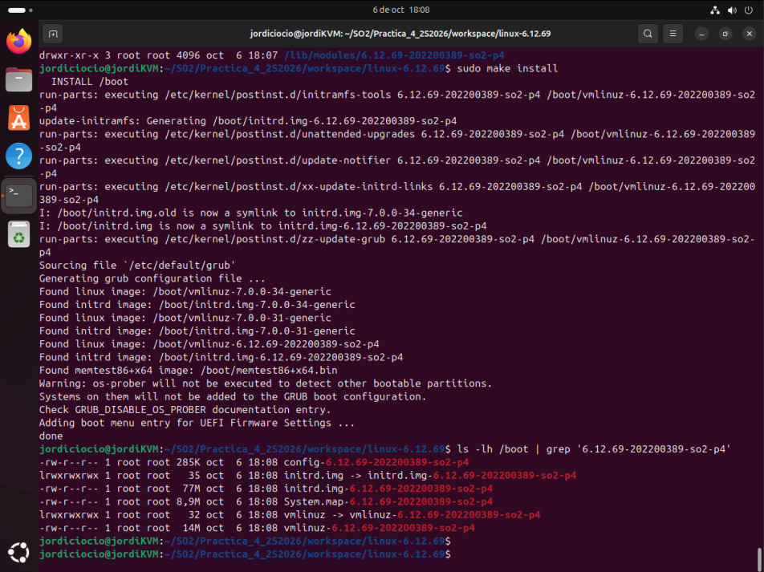
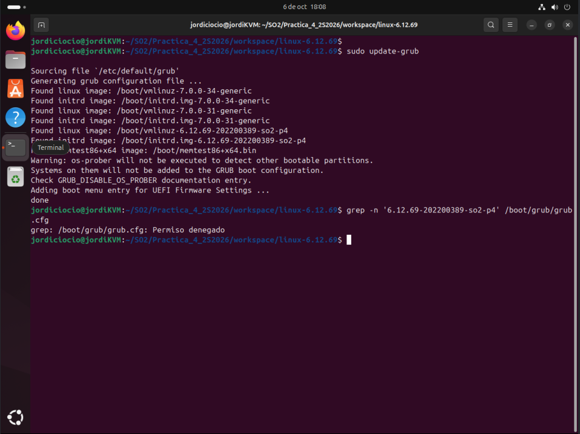
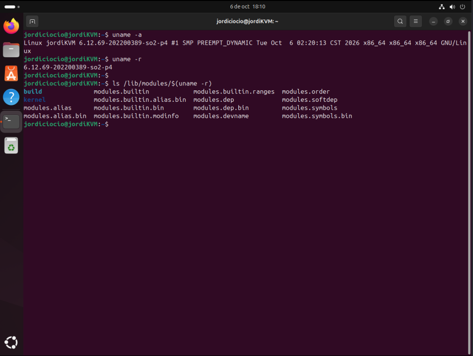

# Práctica 4 - Integración de Syscalls
## Sistema de Monitoreo y Seguridad con Dashboard en Tiempo Real

**Curso:** Sistemas Operativos 2  
**Universidad:** Universidad de San Carlos de Guatemala  
**Facultad:** Facultad de Ingeniería  
**Carrera:** Ingeniería en Ciencias y Sistemas  
**Carné:** 202200389  
**Kernel base:** Linux 6.12.69  
**Kernel personalizado:** `6.12.69-202200389-so2-p4`

---

## 1. Introducción

La Práctica 4 integra los mecanismos desarrollados previamente en las Prácticas 2 y 3 para construir un sistema de monitoreo del sistema operativo con visualización en tiempo real.

En la Práctica 2 se desarrollaron llamadas al sistema orientadas a la consulta de procesos. En la Práctica 3 se implementó un canal IPC bloqueante y un mecanismo de monitoreo de archivos mediante un hilo del kernel.

En esta práctica se reutilizan ambas soluciones dentro de un único kernel Linux 6.12.69 y se adapta el canal IPC para que los eventos detectados por `log_watch` puedan despertar a un proceso en espacio de usuario sin utilizar polling continuo.

El sistema final se compone de tres capas:

1. Kernel modificado.
2. Programa intermedio o daemon en C.
3. Dashboard web.

---

## 2. Objetivo de la integración

El objetivo principal es reutilizar las syscalls de las prácticas anteriores y coordinarlas dentro de una misma solución.

Las funcionalidades integradas son:

- Consulta detallada de un proceso mediante PID.
- Consulta del estado general de los procesos.
- Comunicación IPC bloqueante.
- Monitoreo de archivos mediante un hilo del kernel.
- Notificación de eventos de seguridad desde `log_watch` hacia espacio de usuario.
- Obtención de métricas de memoria mediante `/proc/meminfo`.
- Exposición de información mediante JSON hacia un dashboard web.

---

## 3. Arquitectura general

La arquitectura de la solución es la siguiente:

```text
                       Linux 6.12.69
                    KERNEL MODIFICADO
                           |
          +----------------+----------------+
          |                |                |
   Procesos del SO     log_watch        Cola IPC
          |                |                |
 get_process_info           |                |
 get_processes_state        |                |
          |                 |                |
          |        Detecta palabra clave     |
          |                 |                |
          |                 +-------> IPC ---+
          |                                  |
          +---------------+------------------+
                          |
                     Daemon en C
                          |
              +-----------+-----------+
              |                       |
         /proc/meminfo           Evento IPC
              |                       |
              +-----------+-----------+
                          |
                         JSON
                          |
                    HTTP / WebSocket
                          |
                      Dashboard
```

El kernel concentra las seis llamadas al sistema reutilizadas. El daemon actúa como intermediario entre el kernel y el frontend. El dashboard consume la información generada por el daemon.

---

## 4. Syscalls integradas

Durante la integración se conservaron las seis llamadas al sistema desarrolladas previamente.

| Número | Syscall | Origen | Función |
|---:|---|---|---|
| 548 | `get_process_info` | Práctica 2 | Obtiene información detallada de un proceso a partir de su PID. |
| 549 | `get_processes_state` | Práctica 2 | Obtiene información general sobre los estados de los procesos. |
| 550 | `ipc_channel_send` | Práctica 3 | Envía mensajes hacia la cola IPC. |
| 551 | `ipc_channel_receive` | Práctica 3 | Espera y recibe mensajes desde la cola IPC. |
| 552 | `start_log_watch` | Práctica 3 | Inicia el monitoreo de uno o más archivos mediante un hilo del kernel. |
| 553 | `stop_log_watch` | Práctica 3 | Detiene un monitor activo. |

La numeración final fue reorganizada porque las Prácticas 2 y 3 fueron desarrolladas de forma independiente y originalmente existía una colisión en los números utilizados.

---

## 5. Reutilización de Práctica 2

### 5.1 `get_process_info`

La syscall `get_process_info` permite consultar la información de un proceso específico a partir de su PID.

La implementación obtiene información desde las estructuras internas del kernel y utiliza `copy_to_user` para transferir los datos hacia espacio de usuario.

Entre los datos consultados se encuentran:

- nombre del proceso;
- PID;
- tiempo de ejecución;
- uso aproximado de memoria.

En el sistema final será utilizada por el dashboard cuando el usuario realice una consulta por PID.

### 5.2 `get_processes_state`

La syscall `get_processes_state` recorre los procesos activos del sistema y obtiene métricas generales relacionadas con sus estados.

Entre las métricas se encuentran:

- número total de procesos;
- procesos en ejecución;
- procesos dormidos o idle;
- procesos zombie.

A diferencia de los eventos de seguridad, esta información representa estado del sistema, por lo que el daemon puede consultarla periódicamente.

---

## 6. Reutilización de Práctica 3

### 6.1 Canal IPC

El canal IPC utiliza una cola circular con capacidad para 16 mensajes.

Los principales elementos utilizados son:

- `so2_ipc_queue`: almacenamiento de mensajes;
- `so2_ipc_lengths`: longitud de cada mensaje;
- `so2_ipc_head`: posición de lectura;
- `so2_ipc_tail`: posición de escritura;
- `so2_ipc_count`: cantidad de mensajes disponibles;
- `so2_ipc_mutex`: protección de acceso concurrente;
- `so2_ipc_wait_queue`: cola de espera para receptores.

Cuando no existen mensajes disponibles, `ipc_channel_receive` utiliza:

```c
wait_event_interruptible(...)
```

Esto permite que el proceso receptor quede dormido hasta que exista un mensaje o se reciba una señal.

Cuando se inserta un nuevo mensaje, se utiliza:

```c
wake_up_interruptible(...)
```

para despertar a los procesos que estén esperando.

### 6.2 `start_log_watch` y `stop_log_watch`

`start_log_watch` crea un hilo del kernel encargado de monitorear los archivos configurados.

Cada monitor conserva información como:

- identificador del monitor;
- rutas de archivos;
- posiciones de lectura;
- palabra clave;
- ruta del log central;
- información parcial de líneas todavía incompletas.

`stop_log_watch` permite finalizar un monitor mediante su identificador.

---

## 7. Adaptación principal de Práctica 4: `log_watch` hacia IPC

La modificación principal de la Práctica 4 consiste en utilizar el canal IPC como mecanismo de notificación de eventos.

En la implementación original de Práctica 3, `ipc_channel_send` estaba diseñado para recibir mensajes desde espacio de usuario.

Su interfaz recibe un puntero marcado como `__user` y utiliza:

```c
copy_from_user(...)
```

Por esta razón no es correcto llamar directamente a la syscall `ipc_channel_send` desde el hilo de `log_watch`, ya que el mensaje generado por dicho hilo ya se encuentra en espacio de kernel.

Para resolverlo se creó una función auxiliar interna:

```c
static int so2_ipc_enqueue_kernel(const char *mensaje, size_t len)
```

Esta función contiene la lógica común para insertar un mensaje dentro de la cola IPC.

El flujo quedó dividido de la siguiente manera:

```text
Espacio de usuario
       |
ipc_channel_send
       |
copy_from_user
       |
so2_ipc_enqueue_kernel
       |
    Cola IPC
```

Mientras que para `log_watch`:

```text
log_watch
    |
detecta palabra clave
    |
so2_log_write_match
    |
so2_ipc_enqueue_kernel
    |
 Cola IPC
    |
wake_up_interruptible
    |
daemon despierta
```

De esta manera se reutiliza la misma cola sin tratar memoria del kernel como memoria de usuario.

### Evidencia



---

## 8. Formato de los eventos de seguridad

Cuando `log_watch` encuentra una coincidencia se construye un mensaje con el formato:

```text
SECURITY|ID|ARCHIVO|PALABRA|CONTENIDO
```

Ejemplo:

```text
SECURITY|1|/tmp/app.log|ERROR|ERROR acceso rechazado
```

Este mensaje se inserta en la cola IPC y posteriormente será transformado a JSON por el daemon.

La detección también mantiene la funcionalidad de Práctica 3, por lo que la coincidencia continúa registrándose en el archivo de log central.

---

## 9. ¿Por qué utilizar IPC y no polling?

Un diseño basado únicamente en polling obligaría al daemon a consultar constantemente si existe un evento nuevo.

Esto produciría ejecuciones innecesarias incluso cuando no haya actividad.

Con el diseño implementado ocurre lo siguiente:

1. El daemon llama a `ipc_channel_receive`.
2. Si no existen mensajes, el proceso queda bloqueado.
3. `log_watch` continúa ejecutándose dentro del kernel.
4. Cuando se detecta la palabra clave, se crea una notificación.
5. La notificación se agrega a la cola IPC.
6. Se ejecuta `wake_up_interruptible`.
7. El daemon despierta y recibe el mensaje.
8. El evento puede enviarse inmediatamente al dashboard.

Por lo tanto, el mecanismo sigue un patrón productor-consumidor:

```text
Productor                  Consumidor
log_watch                  daemon
    |                         |
detecta evento               |
    |                         |
encola mensaje  -----------> |
                              |
                    ipc_channel_receive
                              |
                         procesa evento
```

Este diseño evita que el daemon desperdicie CPU preguntando constantemente por eventos que todavía no existen.

---

## 10. Métricas de memoria

No se implementó una syscall adicional para las métricas de memoria.

El daemon utilizará la interfaz ya proporcionada por el sistema:

```text
/proc/meminfo
```

A partir de este archivo se obtendrán los valores necesarios para el dashboard, incluyendo:

- memoria usada;
- memoria libre;
- memoria caché;
- swap utilizada.

---

## 11. Configuración y compilación del kernel

El kernel utilizado corresponde a Linux 6.12.69.

La configuración principal utilizada fue:

```text
CONFIG_LOCALVERSION="-202200389-so2-p4"
# CONFIG_LOCALVERSION_AUTO is not set
CONFIG_SYSTEM_TRUSTED_KEYS=""
CONFIG_SYSTEM_REVOCATION_KEYS=""
CONFIG_DEBUG_INFO_NONE=y
```

La versión resultante es:

```text
6.12.69-202200389-so2-p4
```

Antes de realizar la compilación completa se compiló únicamente el archivo modificado:

```bash
make -j1 kernel/sys.o
```

El resultado fue satisfactorio:

```text
CALL    scripts/checksyscalls.sh
DESCEND objtool
INSTALL libsubcmd_headers
CC      kernel/sys.o
```

Posteriormente se realizó la compilación completa:

```bash
make -j1
```

La compilación produjo correctamente:

```text
Kernel: arch/x86/boot/bzImage is ready (#1)
```

Los artefactos generados fueron:

```text
arch/x86/boot/bzImage   14M
System.map              8.9M
vmlinux                 67M
```

### Evidencia



---

## 12. Instalación y arranque

Después de compilar el kernel se instalaron sus módulos y la imagen correspondiente.

Se verificó la presencia del kernel personalizado dentro de `/boot` y posteriormente se actualizó GRUB.

### Evidencia de instalación



### Evidencia de GRUB



Finalmente se reinició la máquina virtual y se comprobó que el sistema arrancara utilizando el kernel personalizado.

### Evidencia del kernel en ejecución



> **Nota:** actualmente esta evidencia tiene el nombre `05_uname_p4.png.png`. Si el archivo se renombra a `05_uname_p4.png`, también debe modificarse esta referencia.

---

## 13. Problemas encontrados durante la integración

### 13.1 Colisión en la numeración de syscalls

#### Problema

Las Prácticas 2 y 3 fueron desarrolladas de manera independiente.

Práctica 2 utilizaba:

```text
548 get_process_info
549 get_processes_state
```

Mientras que Práctica 3 utilizaba:

```text
548 ipc_channel_send
549 ipc_channel_receive
550 start_log_watch
551 stop_log_watch
```

Por lo tanto, ambas implementaciones no podían integrarse directamente dentro de la misma tabla de syscalls.

#### Causa

Cada práctica fue desarrollada sobre un árbol independiente del kernel Linux 6.12.69 y utilizó los primeros números disponibles a partir de 548.

#### Solución

Se conservaron las llamadas de Práctica 2 y se desplazaron las llamadas de Práctica 3.

La numeración definitiva quedó:

```text
548 get_process_info
549 get_processes_state
550 ipc_channel_send
551 ipc_channel_receive
552 start_log_watch
553 stop_log_watch
```

La integración se validó mediante `make prepare` y posteriormente compilando `kernel/sys.o`.

---

### 13.2 Incompatibilidad entre `copy_from_user` y mensajes generados por `log_watch`

#### Problema

La syscall `ipc_channel_send` utiliza `copy_from_user`, debido a que fue diseñada para recibir un puntero proveniente de espacio de usuario.

Sin embargo, en Práctica 4 el hilo `log_watch` necesita enviar una notificación cuyo buffer ya se encuentra en espacio de kernel.

Utilizar directamente la syscall con dicho buffer mezclaría incorrectamente ambos espacios de memoria.

#### Solución

Se creó:

```c
static int so2_ipc_enqueue_kernel(const char *mensaje, size_t len)
```

Esta función maneja únicamente la inserción en la cola.

`ipc_channel_send` conserva la copia segura desde espacio de usuario y posteriormente utiliza el helper.

`log_watch` utiliza directamente el helper porque ya se encuentra ejecutándose dentro del kernel.

---

### 13.3 Verificación de artefactos desde un directorio incorrecto

#### Problema

Después de finalizar la compilación se intentaron comprobar los archivos con:

```bash
ls -lh arch/x86/boot/bzImage vmlinux System.map
```

mientras el directorio actual era `/home/jordiciocio`.

El sistema respondió indicando que los archivos no existían.

#### Causa

Las rutas utilizadas eran relativas al directorio raíz del código fuente de Linux.

#### Solución

Se ingresó al directorio correcto:

```bash
cd ~/SO2/Practica_4_2S2026/workspace/linux-6.12.69
```

y se repitió la comprobación.

Los archivos fueron encontrados correctamente:

```text
arch/x86/boot/bzImage   14M
System.map              8.9M
vmlinux                 67M
```

Este problema no correspondía a una falla en la compilación, sino a una ruta de verificación incorrecta.

---

## 14. Programa intermedio

El programa intermedio se desarrolla en lenguaje C y será responsable de orquestar la comunicación entre el kernel y el dashboard.

Sus responsabilidades son:

- iniciar el monitoreo mediante `start_log_watch`;
- permanecer bloqueado esperando eventos mediante `ipc_channel_receive`;
- consultar periódicamente el estado de los procesos;
- leer `/proc/meminfo`;
- ejecutar `get_process_info` cuando se solicite un PID específico;
- transformar la información obtenida a JSON;
- exponer los datos al frontend;
- manejar errores sin detener completamente el servicio.

El JSON deberá contener al menos una estructura equivalente a:

```json
{
  "memoria_usada": 0,
  "memoria_libre": 0,
  "memoria_cache": 0,
  "swap_usada": 0,
  "procesos": [
    {
      "nombre": "",
      "pid": 0,
      "estado": ""
    }
  ],
  "eventos_seguridad": [
    {
      "archivo_origen": "",
      "palabra_detectada": "",
      "contenido": "",
      "timestamp": ""
    }
  ]
}
```

---

## 15. Dashboard web

El dashboard debe presentar la información obtenida por el daemon.

Las visualizaciones requeridas son:

1. Gráfico circular de memoria usada, libre y caché.
2. Gráfico de líneas para observar la evolución de memoria física y swap.
3. Tabla de procesos activos.
4. Panel de eventos de seguridad actualizado en tiempo real.
5. Consulta detallada de un proceso por PID.

El panel de seguridad debe recibir los eventos generados por el mecanismo IPC. No debe depender de actualizar manualmente la página ni de polling continuo sobre los eventos.

---

## 16. Estado actual de la práctica

Al momento de esta documentación se ha completado:

- preparación del kernel Linux 6.12.69;
- integración de las syscalls de Práctica 2;
- integración de las syscalls de Práctica 3;
- resolución de la colisión de números;
- implementación del helper interno IPC;
- integración de `log_watch` con la cola IPC;
- compilación individual de `kernel/sys.o`;
- compilación completa del kernel;
- generación de `bzImage`, `System.map` y `vmlinux`;
- instalación del kernel;
- actualización de GRUB;
- arranque del kernel P4.

Las siguientes etapas corresponden a las pruebas funcionales de las syscalls, el desarrollo del daemon, la generación del JSON y la construcción del dashboard.
