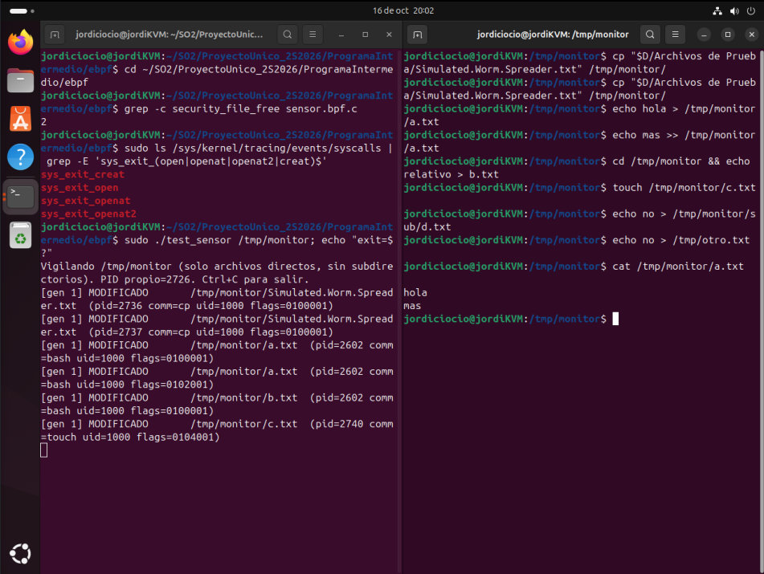
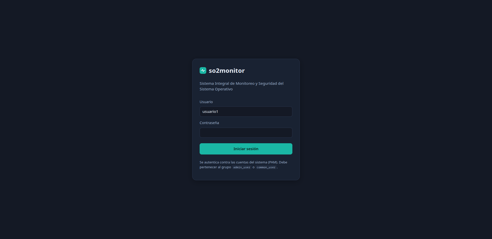
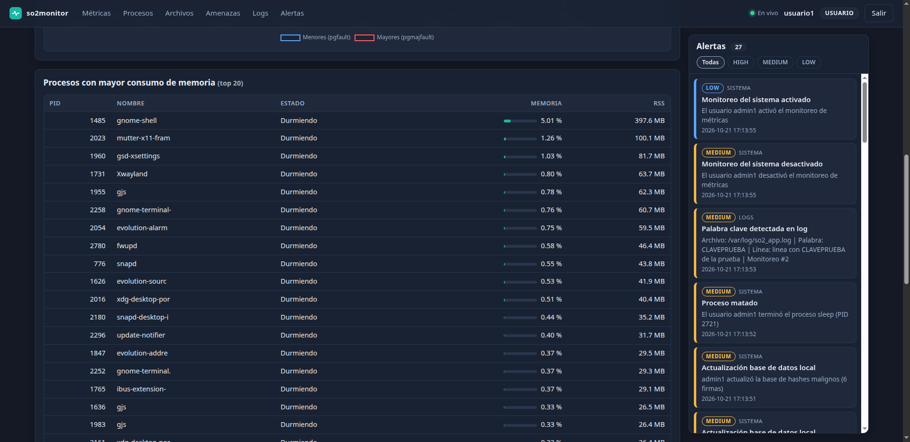
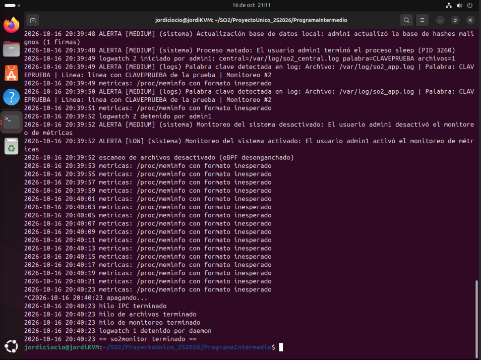

# Manual Técnico — Sistema Integral de Monitoreo y Seguridad

Sistemas Operativos 2 · Proyecto Único · Carné 202200389
Kernel Linux **6.12.69** (`6.12.69-202200389-so2-final`) · Ubuntu 24.04 (VM QEMU/KVM) · Fedora 44 (host)

---

## Índice

1. [Visión general](#1-visión-general)
2. [Reproducir el entorno](#2-reproducir-el-entorno)
3. [Capa kernel: syscalls reutilizadas](#3-capa-kernel-syscalls-reutilizadas)
4. [Sensor eBPF](#4-sensor-ebpf)
5. [Programa intermedio (daemon)](#5-programa-intermedio-daemon)
6. [Seguridad: PAM, roles y permisos](#6-seguridad-pam-roles-y-permisos)
7. [Conexión con el frontend](#7-conexión-con-el-frontend)
8. [Pruebas realizadas](#8-pruebas-realizadas)
9. [Errores encontrados y cómo se resolvieron](#9-errores-encontrados-y-cómo-se-resolvieron)
10. [Limitaciones conocidas](#10-limitaciones-conocidas)
11. [Estructura del repositorio](#11-estructura-del-repositorio)

---

## 1. Visión general

El sistema combina tres capas. Cada una hace una sola cosa y la regla de diseño es que **toda decisión de seguridad
ocurre en el daemon**, no en el kernel (requerimiento 13 del enunciado). Las únicas lógicas permitidas en el kernel
son el filtro por ruta del sensor eBPF y la coincidencia de palabra clave de `sys_start_log_watch` (Práctica 3).

```text
 ┌──────────────────────────────── KERNEL 6.12.69 ────────────────────────────────┐
 │  548 get_process_info    549 get_processes_state (lista por proceso)           │
 │  550/551 ipc_channel_send/receive   552/553 start/stop_log_watch               │
 │                                                                                │
 │  Sensor eBPF ── tracepoints sys_exit_{openat,openat2,open,creat} + kprobe      │
 │                 security_file_free ──► RING BUFFER ──┐                         │
 │  kthread log_watch ──► cola IPC (so2_ipc_enqueue_kernel) ─────┐                │
 └───────────────────────────────────────────────────────────────┼────────────────┘
                                                                 │
 ┌──────────────────────── DAEMON so2monitor (C, root) ──────────┼────────────────┐
 │  Hilo 1  MONITOREO  /proc/meminfo, /proc/vmstat, syscall 549, alertas          │
 │  Hilo 2  ARCHIVOS   ring_buffer__poll → SHA-256 → blacklist → cuarentena ◄─────┘ (ring buffer)
 │  Hilo 3  IPC        bloqueado en sys_ipc_channel_receive (sin polling) ◄───────── (cola IPC)
 │  Hilos   HTTP       servidor propio: API REST + SSE + archivos del dashboard     │
 └──────────────────────────────────────┬─────────────────────────────────────────┘
                                        │ JSON por HTTP / Server-Sent Events
                              ┌─────────▼─────────┐
                              │ DASHBOARD (HTML/  │  login PAM · roles admin / común
                              │ CSS/JS + Chart.js)│
                              └───────────────────┘
```

| Componente | Tecnología | Carpeta |
|---|---|---|
| Syscalls | C, kernel 6.12.69 | `Kernel/` |
| Sensor eBPF | C compilado con Clang/LLVM, libbpf (CO-RE) | `ProgramaIntermedio/ebpf/` |
| Daemon | C (pthreads, libbpf, OpenSSL, PAM) | `ProgramaIntermedio/src/` |
| Dashboard | HTML, CSS, JavaScript, Chart.js 4.4.1 | `Dashboard/` |

---

## 2. Reproducir el entorno

> Para instalar todo **desde cero en una máquina nueva** (kernel, usuarios, daemon y dashboard), con los resultados esperados
> en cada paso, sigue la [Guía de instalación desde cero](Guia_Instalacion_Desde_Cero.md). Esta sección resume lo esencial.

### 2.1 Kernel

El kernel debe incluir soporte eBPF con BTF (requerimiento 15). En las prácticas 1–4 se compilaba **sin** BTF para ahorrar
disco y RAM; el proyecto exige `CONFIG_DEBUG_INFO_BTF=y`, que necesita información de depuración DWARF y la herramienta
`pahole`. Para que cupiera en los ~22 GB libres de la VM se usó `make localmodconfig` (73 módulos en lugar de miles) y
`INSTALL_MOD_STRIP=1` al instalar.

Opciones verificadas en la `.config` final:

```text
CONFIG_BPF=y            CONFIG_BPF_SYSCALL=y      CONFIG_BPF_EVENTS=y
CONFIG_DEBUG_INFO_BTF=y CONFIG_FTRACE_SYSCALLS=y  CONFIG_TRACEPOINTS=y
CONFIG_LOCALVERSION="-202200389-so2-final"        # CONFIG_LOCALVERSION_AUTO is not set
```

Pasos (los scripts están en `scripts/`, numerados en orden):

```bash
# VM Ubuntu 24.04, con ~/SO2/recursos/linux-6.12.69.tar.xz y una config base de Ubuntu
./scripts/02_dependencias.sh        # build-essential, dwarves (pahole), clang, libbpf, PAM...
./scripts/02a_obtener_fuentes.sh    # descarga linux-6.12.69 de kernel.org (verifica SHA-256) y la config base
./scripts/03_preparar_arbol.sh      # extrae Linux limpio y copia encima Kernel/{kernel,include,arch}
./scripts/04_configurar_kernel.sh   # .config con BTF + eBPF (verifica cada opción)
./scripts/05_compilar.sh            # ~16 min con 4 vCPU y 8 GiB de RAM (JOBS=N opcional)
./scripts/06_instalar.sh            # modules_install (strip), install, update-grub
sudo reboot                         # elegir ...-so2-final en GRUB
./scripts/07_verificar_kernel.sh    # BTF, soporte eBPF, tracepoints, syscalls 548/549
```

El repositorio contiene solo los **archivos modificados** del kernel, siguiendo la estructura original
(`Kernel/kernel/sys.c`, `Kernel/include/linux/syscalls.h`, `Kernel/arch/x86/entry/syscalls/syscall_64.tbl`).

### 2.2 Daemon y sensor

```bash
sudo apt install build-essential clang llvm libbpf-dev libpam0g-dev libssl-dev libelf-dev zlib1g-dev pkg-config
cd ProgramaIntermedio
make                                 # genera el esqueleto del sensor (ebpf/) y ./so2monitor
sudo ./scripts/instalar_sistema.sh   # grupos admin_user/common_user, servicio PAM, /tmp/monitor, logs
sudo ./scripts/crear_usuario.sh admin1 admin
sudo ./scripts/crear_usuario.sh usuario1 common
sudo ./so2monitor -f                 # primer plano; sin -f se ejecuta como daemon
```

`make` ejecuta `bpftool btf dump file /sys/kernel/btf/vmlinux format c` para generar `vmlinux.h`, compila el sensor con
`clang -target bpf` y genera el esqueleto con `bpftool gen skeleton`. Esos artefactos no se versionan (`.gitignore`).
El ejecutable compilado `so2monitor` se incluye en el repositorio.

Configuración: `ProgramaIntermedio/config/daemon.json` (puerto, ruta vigilada, intervalo, servicio PAM, monitoreos de
logs que se inician al arrancar, etc.).

---

## 3. Capa kernel: syscalls reutilizadas

No se implementó ninguna syscall nueva. Se integraron las de las prácticas 2 y 3 con la numeración que resolvió el choque
de la Práctica 4:

| N.º | Syscall | Origen | Función en el sistema |
|---|---|---|---|
| 548 | `get_process_info(pid, *info)` | P2 | Detalle de un PID (nombre, tiempo de ejecución, memoria) → consulta por PID del dashboard |
| 549 | `get_processes_state(*state, *procs, max)` | P2 (ampliada) | Contadores y **lista por proceso** → top 20 por memoria |
| 550 | `ipc_channel_send(msg)` | P3 | Canal IPC: lo usa el usuario para enviar |
| 551 | `ipc_channel_receive(buf)` | P3 | El hilo IPC del daemon duerme aquí |
| 552 | `start_log_watch(rutas, n, central, palabra)` | P3 | Se invoca al arrancar y desde el dashboard |
| 553 | `stop_log_watch(id)` | P3 | Se invoca al finalizar un monitoreo y al apagar el daemon |

El enunciado pide que `sys_get_processes_state` entregue «por proceso, al menos PID, nombre, estado y memoria (RSS)». La
versión de la P2 solo devolvía cuatro contadores, así que se **amplió la misma syscall** (mismo número, sin duplicar
funcionalidad):

```c
struct so2_process_entry  { pid_t pid; char state; char name[TASK_COMM_LEN]; unsigned long rss_kb; };
struct so2_processes_state { unsigned long total, running, sleeping, zombie, count; };

SYSCALL_DEFINE3(get_processes_state, struct so2_processes_state __user *, user_state,
                struct so2_process_entry __user *, user_procs, unsigned int, max_procs)
```

- Siempre rellena los contadores. Si `user_procs` no es `NULL` y `max_procs > 0`, escribe hasta `max_procs` entradas
  (tope de 4096) y deja en `count` cuántas escribió.
- Recorre los procesos con `for_each_process` bajo `rcu_read_lock()`. El nombre y el RSS se leen con `task_lock(task)`,
  que protege `comm` y evita que `mm` se libere mientras se lee (patrón usado por `oom_badness`). El buffer se reserva con
  `kvcalloc` **antes** de entrar en la sección RCU, porque no se puede dormir dentro de ella.
- El estado (`R`, `S`, `D`, `I`, `T`, `t`, `Z`) se deriva de `__state` y `exit_state`.
- Se cambió `pr_info` por `pr_debug` en esta syscall: el daemon la invoca cada 2 s y llenaría el registro del kernel.

### 3.1 IPC y `log_watch` (rediseño de la Práctica 4)

`sys_ipc_channel_send` espera un puntero de usuario y usa `copy_from_user`; `log_watch` corre en un hilo del kernel y no
puede llamarla con un buffer del kernel. Se extrajo la lógica común a un helper interno:

```text
usuario ──► sys_ipc_channel_send ─ copy_from_user ─┐
                                                   ├─► so2_ipc_enqueue_kernel() ─► cola FIFO (16 × 256 B)
kthread log_watch ─ so2_log_write_match ───────────┘            │ wake_up_interruptible
                                                                ▼
                                    sys_ipc_channel_receive (wait_event_interruptible)
```

Al detectar la palabra clave, el hilo escribe en el log central **y** encola
`SECURITY|ID|ARCHIVO|PALABRA|CONTENIDO`. El daemon duerme en la 551 y despierta solo cuando hay un mensaje:
cero CPU en espera, sin sondeo. (Un monitoreo nuevo lee el archivo vigilado desde el principio; ver §10.)

---

## 4. Sensor eBPF

Código: `ProgramaIntermedio/ebpf/sensor.bpf.c` (+ `sensor.h` con las estructuras compartidas y `Makefile`).
Hace **solo filtrado por ruta** y envía metadatos; el hash, la severidad y la cuarentena los decide el daemon.

### 4.1 Puntos de enganche

| Programa | Enganche | Qué hace |
|---|---|---|
| `handle_openat_exit`, `_openat2_`, `_open_`, `_creat_` | tracepoints `syscalls:sys_exit_openat`, `…openat2`, `…open`, `…creat` | Si el archivo se abrió para escritura y está **directamente** en el directorio configurado, lo registra |
| `handle_file_free` | `kprobe/security_file_free` | Cuando el kernel libera el `struct file` (se cerró el último descriptor), emite el evento |

**Por qué `sys_exit_*` y no `sys_enter_openat`.** La ruta que llega a `sys_enter_openat` es el texto que escribió el
proceso: puede ser relativa o traer `..`, y no se ve el directorio de trabajo. En `sys_exit_*` el kernel ya la resolvió:
con el descriptor devuelto se obtiene el `struct file` (`task->files->fdt->fd[fd]`) y de ahí la ruta real.

**Por qué se emite al liberar el archivo y no en `close`.** La redirección de bash (`echo x > archivo`) hace
`open → dup2(fd,1) → close(fd) → write(1,…)`: el `close` ocurre **antes** de escribir y el daemon calcularía el hash de un
archivo vacío. Al seguir el `struct file` y emitir en `security_file_free`, el evento llega cuando se cerró el *último*
descriptor, con el contenido completo; además resuelve `dup`, `fork` y procesos que mueren sin `close`. Esto implica que no
hace falta enganchar `write` (que habría costado una ejecución del programa por cada `write` del sistema).

### 4.2 Mapas

| Mapa | Tipo | Contenido |
|---|---|---|
| `cfg_map` | `ARRAY` (1) | Directorio vigilado como lista de componentes **de la hoja a la raíz** (`/tmp/monitor` → `monitor`, `tmp`) y una generación `gen`. Lo escribe el daemon con `bpf_map_update_elem()` |
| `daemon_pid` | `ARRAY` (1) | PID (tgid) del daemon. Sus propios eventos se descartan |
| `watched` | `LRU_HASH` (4096) | Clave: puntero al `struct file`. Valor: pid, uid, comm, flags, `gen` y nombre del archivo |
| `scratch` | `PERCPU_ARRAY` (1) | Buffer de trabajo (la pila de eBPF solo tiene 512 bytes) |
| `events` | `RINGBUF` (256 KiB) | Eventos hacia el daemon |

### 4.3 Filtro de ruta

Se recorren los *dentries* hacia la raíz comparando cada componente con la lista de `cfg_map` (como máximo 8 niveles de
64 caracteres), **cruzando puntos de montaje** (`mnt_mountpoint`/`mnt_parent` de `struct mount`) para que funcione en
`/tmp`, `/home` u otros sistemas de archivos. Hay coincidencia solo si, tras consumir todos los componentes, lo que queda
es la raíz real: así un archivo en un subdirectorio **no** coincide (el enunciado excluye subdirectorios). Se usa CO-RE
(`BPF_CORE_READ`) para que el objeto sea portable entre versiones.

### 4.4 Ring buffer y comunicación con el daemon

```c
struct sensor_event { __u32 pid, tid, uid, flags, gen, pad; char comm[16]; char name[256]; };
```

El evento lleva solo el **nombre** del archivo; el directorio lo conoce el daemon. El daemon descarta los eventos cuya
`gen` no coincide con la configuración vigente (llegados de una ruta anterior). El flujo en espacio de usuario
(`fswatch.c`) es:

1. `sensor_bpf__open_and_load()` y registro de su PID en `daemon_pid` (evita el bucle infinito: abrir un archivo para
   calcular su hash generaría otro evento).
2. `fs_set_dir()` escribe `cfg_map` **antes** de enganchar.
3. `sensor_bpf__attach()` / `sensor_bpf__detach()` implementan «activar/desactivar escaneo» desde el dashboard.
4. `ring_buffer__poll()` (sobre `epoll`, bloquea hasta 200 ms) entrega cada evento al *callback*.

El kernel limpia `O_CREAT`/`O_TRUNC` de `f_flags` al terminar de abrir, por lo que el sensor no puede distinguir crear de
modificar: lo decide el daemon según si ya conocía el archivo.

Evidencia de la prueba del filtro (8 comandos, 5 eventos; los de subdirectorio, otro directorio y solo lectura no generan
ninguno):



---

## 5. Programa intermedio (daemon)

Código en `ProgramaIntermedio/src/`. Un módulo por responsabilidad:

| Módulo | Responsabilidad |
|---|---|
| `main.c` | Configuración JSON, demonización (`fork` doble + `setsid`), señales, creación de hilos, apagado ordenado |
| `metrics.c` | **Hilo 1.** `/proc/meminfo`, `/proc/vmstat` (deltas de `pgfault`/`pgmajfault`), top 20 vía 549, `sys_kill` con protecciones |
| `fswatch.c` | **Hilo 2.** Carga del sensor, SHA-256 (OpenSSL EVP), tabla de archivos, cuarentena |
| `logwatch.c` | **Hilo 3.** Bloqueado en la 551; alta/baja de monitoreos de logs |
| `blacklist.c` | Tabla hash en memoria de firmas SHA-256; validación del JSON |
| `alerts.c` | Anillo de las últimas 500 alertas y envío en vivo |
| `auth.c` | PAM, roles por grupo, sesiones |
| `http.c` | Servidor HTTP, API, SSE, archivos estáticos |
| `common.c` | Registro de eventos (log), lectura de archivos, bandera de apagado |
| `ksys.h` | Números de syscall y estructuras compartidas con el kernel |

### 5.1 Hilos y sincronización

Los tres hilos obligatorios se crean en `main()`; además hay un hilo que acepta conexiones HTTP y uno por conexión.

| Hilo | Función | Bloquea en |
|---|---|---|
| Monitoreo | cada 2 s lee `/proc`, llama a la 549, genera y publica | `msleep_run` (tramos de 100 ms) |
| Archivos | consume el ring buffer | `ring_buffer__poll(200 ms)` |
| IPC | `syscall(551)` | el kernel (`wait_event_interruptible`) |

Cada estructura compartida tiene su `pthread_mutex_t`: alertas, muestras y procesos, tabla de archivos y amenazas,
blacklist, monitoreos de logs, sesiones, clientes SSE y el registro de eventos. Las alertas se publican **fuera** de
cualquier otro *lock* para evitar bloqueos entre módulos.

**Apagado ordenado.** `SIGINT`/`SIGTERM` ponen `g_running = 0`. El hilo IPC está dormido dentro del kernel, así que se le
envía `SIGUSR1` con `pthread_kill` hasta que `pthread_timedjoin_np` lo recoge: el manejador se instala **sin**
`SA_RESTART`, de modo que la syscall devuelve `EINTR`. Después se llama a `sys_stop_log_watch` por cada monitoreo activo,
se desengancha el sensor y se cierra el servidor.

### 5.2 Flujo de un archivo sospechoso

```text
cp muestra.txt /tmp/monitor/
  └► sensor: sys_exit_openat (escritura, ruta coincide) ─► watched[file]
  └► cp cierra el archivo ─► security_file_free ─► RINGBUF
Hilo 2: evento ─► open(O_NOFOLLOW) ─► SHA-256 ─► ¿en blacklist?
          sí ─► fchmod(fd, 0)  ─►  alerta HIGH «Hash malicioso detectado»
                              └─►  alerta HIGH «Archivo puesto en cuarentena»
          no ─► ¿nuevo, o cambió hash/timestamp? ─► alerta LOW «Archivo modificado»
        ─► SSE: evento "file" (y "threat" si es malicioso) ─► dashboard
```

El hash se calcula sobre el descriptor ya abierto con `O_NOFOLLOW`, y la cuarentena usa `fchmod` sobre ese mismo
descriptor: así no hay carrera con un enlace simbólico. Al actualizar la blacklist desde el dashboard, el daemon
**reevalúa los archivos ya conocidos** con el hash guardado (sin releer el disco) y aísla los que ahora coinciden.

### 5.3 Clasificación de alertas

| Severidad | Evento (título exacto) | Origen en el código |
|---|---|---|
| LOW | Archivo modificado | `fswatch.c` |
| LOW | Monitoreo del sistema activado | `metrics.c` |
| LOW | Inicio de sesión exitoso | `http.c` |
| MEDIUM | Monitoreo del sistema desactivado | `metrics.c` |
| MEDIUM | Inicio de sesión fallido | `http.c` |
| MEDIUM | Palabra clave detectada en log | `logwatch.c` (hilo IPC) |
| MEDIUM | Actualización base de datos local | `http.c` |
| MEDIUM | Proceso matado | `metrics.c` |
| HIGH | Hash malicioso detectado | `fswatch.c` |
| HIGH | Archivo puesto en cuarentena (automática o manual) | `fswatch.c` |

Cada alerta lleva tipo (`archivos`, `sistema`, `sesion`, `logs`), descripción, severidad y fecha/hora.

### 5.4 Manejo de errores

El daemon no termina por un fallo recuperable: registra el error y continúa.

- **Syscall que falla** (`549`, `548`, `551`…): se registra el `errno`; el hilo reintenta en el siguiente ciclo. Si la 551
  falla repetidamente se espera 1 s para no entrar en un bucle caliente.
- **Sensor no disponible** (kernel sin BTF/eBPF o sin root): se registra y el resto del daemon sigue; las acciones de
  archivos responden con un error claro. (Se observó al arrancar con el kernel de la P4, que no tiene BTF.)
- **Entradas inválidas**: la blacklist se valida completa **antes** de reemplazar la vigente (sintaxis, objeto raíz,
  `hash` de 64 hex, `descripcion` textual); un archivo rechazado no altera la tabla activa. Las rutas deben ser absolutas;
  un monitoreo no puede vigilar su propio log central.
- **Archivo desaparecido** entre el evento y el hash: se omite en silencio.
- **Puerto ocupado o configuración inexistente**: el daemon termina de forma ordenada con un mensaje.
- **Límites**: 64 conexiones HTTP, 32 clientes SSE, 64 sesiones, 1000 archivos en la tabla, cuerpos de hasta 1 MiB.
- **Protecciones de `kill`**: no PID 1, no el propio daemon, no hilos del kernel (`PF_KTHREAD` en `/proc/PID/stat`).
- **Cuarentena manual**: solo sobre archivos que el sensor ya analizó; nunca sobre rutas arbitrarias.

### 5.5 Persistencia y arranque

La blacklist subida desde el dashboard se guarda de forma atómica (archivo temporal + `rename`) en
`config/blacklist.json`. El directorio vigilado de la configuración se crea con permisos `1777` si no existe (`/tmp` se
vacía en cada arranque). Al iniciar, el daemon invoca `sys_start_log_watch` con los monitoreos del archivo de
configuración y los detiene con `sys_stop_log_watch` al terminar.

---

## 6. Seguridad: PAM, roles y permisos

- **Autenticación real con PAM** (`pam_start` → `pam_authenticate` → `pam_acct_mgmt`) con el servicio `/etc/pam.d/so2-monitor`
  (`@include common-auth` y `common-account`): se valida contra las cuentas del sistema, sin credenciales en el código.
- **Roles por grupo del sistema** (`getgrouplist`): `admin_user` → administrador; `common_user` → usuario común. Quien
  pertenece a ambos es administrador; quien no pertenece a ninguno **no entra** aunque su contraseña sea correcta.
- **Sesiones**: token aleatorio de 256 bits (`/dev/urandom`), cookie `HttpOnly; SameSite=Strict`, caducidad de 8 horas.
- **Los permisos se aplican en el daemon (C)**, no ocultando botones: cada ruta administrativa comprueba el rol y responde
  `403` al usuario común (verificado en las pruebas).

| Acción | Administrador | Usuario | Ruta |
|---|:--:|:--:|---|
| Ver métricas, procesos, alertas, archivos analizados | ✔ | ✔ | `GET /api/state`, `/api/stream` |
| Activar/desactivar monitoreo de métricas | ✔ | ✘ | `POST /api/monitoring` |
| Activar/desactivar escaneo de procesos | ✔ | ✘ | `POST /api/procscan` |
| Activar/desactivar escaneo de archivos (attach/detach eBPF) | ✔ | ✘ | `POST /api/filescan` |
| Configurar ruta a monitorear | ✔ | ✘ | `POST /api/path` |
| Actualizar base de hashes (JSON) | ✔ | ✘ | `POST /api/blacklist` |
| Información de un proceso por PID | ✔ | ✘ | `GET /api/process?pid=` |
| Matar un proceso | ✔ | ✘ | `POST /api/kill` |
| Poner archivos en cuarentena / ver cuarentena | ✔ | ✘ | `POST`/`GET /api/quarantine` |
| Crear / finalizar monitoreo de logs | ✔ | ✘ | `POST /api/logwatch`, `/api/logwatch/stop` |

Evidencia en la interfaz: pantalla de acceso (autenticación contra las cuentas del sistema) y vista del usuario común, donde
la tabla de procesos no ofrece acciones. El daemon, además, rechaza esas acciones con `403` aunque se las invoque directamente.





Otras medidas: el servidor HTTP rechaza rutas con `..` o caracteres fuera de `[A-Za-z0-9._/-]`; el dashboard inserta todo
texto del sistema con `textContent` (un archivo llamado `` se muestra como texto, no se ejecuta).

---

## 7. Conexión con el frontend

El daemon incluye su propio servidor HTTP (hilo por conexión, sin dependencias) y sirve también los archivos del dashboard,
de modo que no hay problemas de CORS. La comunicación es JSON sobre HTTP y **Server-Sent Events** (SSE) para el tiempo real.

| Evento SSE | Cuándo se emite | Contenido |
|---|---|---|
| `metrics` | cada intervalo del monitoreo | muestra de memoria, swap y fallos de página |
| `procs` | cada intervalo | resumen + top 20 por memoria |
| `alert` | al generarse una alerta | tipo, severidad, descripción, hora |
| `file` / `threat` | al analizar un archivo / detectar una amenaza | estado del archivo / firma |
| `flags` | al cambiar un interruptor | monitoreo, procesos, archivos, ruta |
| `logwatches` | al crear/finalizar un monitoreo | lista de monitoreos activos |

Al iniciar sesión el dashboard hace `GET /api/state` (instantánea completa, con el historial para las gráficas) y abre
`/api/stream`; a partir de ahí todo llega empujado, sin refrescar. Las acciones del administrador son `POST` con cuerpo JSON.

**Uso de un framework.** Se emplea **Chart.js 4.4.1** (licencia MIT, incluido en `Dashboard/vendor/` con su licencia)
únicamente para dibujar las gráficas: evita reescribir ejes, leyendas y tooltips, y se distribuye junto al código para que
el dashboard funcione sin internet. El resto (interfaz, lógica y estilos) es HTML, CSS y JavaScript propios. Se incluye
también cJSON 1.7.18 (MIT) en `ProgramaIntermedio/third_party/` para analizar y generar JSON en C.

---

## 8. Pruebas realizadas

`ProgramaIntermedio/scripts/probar_api.sh` ejecuta **58 comprobaciones** de extremo a extremo con `curl` contra el daemon
real (con las cuentas del sistema): sesión y roles (10), permisos del usuario común (8), escaneo de archivos y cuarentena
(16), blacklist (4), procesos y protecciones de `kill` (7), logwatch con IPC (4), interruptores y alertas (7) y cierre de
sesión (2). **Resultado en la VM, con el kernel final tras un arranque en frío: 58 correctas, 0 fallidas.**

Además se probaron a mano: el filtro por ruta del sensor (§4.4), el dashboard con las dos cuentas (capturas en el Manual de
Usuario), y el aislamiento de una ruta como `/etc/passwd` (rechazado; permisos intactos).

---

## 9. Errores encontrados y cómo se resolvieron

**E1 — Métricas vacías: «`/proc/meminfo` con formato inesperado».** La función de lectura de archivos reservaba el buffer
con `st_size`, pero los archivos de `/proc` reportan tamaño 0: se leían 0 bytes y todas las claves parecían ausentes; el
daemon seguía vivo pero sin muestras. *Solución:* leer hasta EOF creciendo el buffer; se añadió una prueba con
`/proc/meminfo`, `/proc/vmstat`, un archivo mayor que el límite y uno inexistente. (Que el límite se ignorara cuando era
menor que el buffer inicial lo detectó esa misma prueba.)



**E2 — `get_processes_state` no entregaba la lista por proceso.** Solo devolvía contadores, y el top 20 necesita PID,
nombre, estado y RSS. *Solución:* ampliar la misma syscall (§3), con el cuidado de reservar la memoria fuera de la sección
RCU y de leer `comm`/`mm` bajo `task_lock`.

**E3 — El evento llegaba antes de que el archivo se escribiera.** Con la primera versión del sensor (evento en `close`),
`echo x > archivo` emitía el evento antes del `write`, así que se hashaba un archivo vacío. *Solución:* seguir el
`struct file` y emitir en `security_file_free` (§4.1). La prueba del filtro mostró además que cada comando generaba un
solo evento.

**E4 — Choque de nombres con `vmlinux.h`.** El mapa se llamaba `config`, que ya existe como tipo en `vmlinux.h`. Clang
rechazó el programa («redefinition of 'config' as different kind of symbol»). *Solución:* renombrarlo a `cfg_map`.

**E5 — La configuración de las prácticas anteriores no servía.** P1–P4 compilaban sin BTF/DWARF; el proyecto exige
`CONFIG_DEBUG_INFO_BTF=y` y la compilación completa de Ubuntu no cabía en el disco. *Solución:* `localmodconfig`, módulos
sin símbolos de depuración al instalar y un script que **verifica** cada opción requerida antes de compilar.

**E6 — Una prueba destruía la blacklist de referencia.** Subir una blacklist válida durante las pruebas la **persistía**
sobre `config/blacklist.json`; el paso «restaurar la oficial» leía ese mismo archivo ya sobrescrito. *Solución:* la
restauración lee la copia de `Drive/blacklist.json`.

**E7 — `/tmp/monitor` desaparecía al reiniciar.** `/tmp` se vacía en cada arranque y el daemon rechazaba su ruta inicial.
*Solución:* el daemon crea ese directorio (permisos `1777`) si falta, solo para la ruta de su archivo de configuración.

**E8 — El sensor no carga en un kernel sin BTF.** Al arrancar la VM con el kernel de la Práctica 4 (compilado sin BTF),
`libbpf` falla con «failed to find valid kernel BTF». *Solución:* el daemon detecta el fallo, lo registra, desactiva solo
el escaneo de archivos y continúa con el resto de funciones, en lugar de caerse; con el kernel final el sensor carga.

---

## 10. Limitaciones conocidas

- **Renombrado:** `mv` dentro del mismo sistema de archivos usa `rename` y no abre el archivo, por lo que no genera evento.
  `cp`, redirecciones y editores sí.
- El directorio vigilado admite hasta 8 niveles de 63 caracteres y no puede ser `/`. Los subdirectorios no se vigilan (por
  enunciado).
- Un monitoreo de `log_watch` nuevo lee el archivo **desde el principio** (comportamiento de la Práctica 3): al iniciar,
  las líneas antiguas que contengan la palabra clave vuelven a generar alertas. Para una demostración limpia conviene
  vaciar el log antes (`: > /var/log/so2_app.log`).
- La detección se basa en hashes exactos: cualquier cambio de un byte en un archivo malicioso lo deja fuera de la
  blacklist (limitación inherente a las firmas por hash).
- El estado (alertas, archivos) vive en memoria: se pierde al reiniciar el daemon. La blacklist sí se persiste.
- No hay límite de intentos de inicio de sesión.

---

## 11. Estructura del repositorio

```text
ProyectoUnico_2S2026/
├── Kernel/                       archivos modificados del kernel 6.12.69
│   ├── kernel/sys.c
│   ├── include/linux/syscalls.h
│   └── arch/x86/entry/syscalls/syscall_64.tbl
├── ProgramaIntermedio/
│   ├── so2monitor                ejecutable compilado
│   ├── Makefile
│   ├── src/                      código del daemon
│   ├── ebpf/                     sensor.bpf.c, sensor.h, Makefile, test_sensor.c
│   ├── config/                   daemon.json, blacklist.json
│   ├── scripts/                  instalar_sistema.sh, crear_usuario.sh, probar_api.sh
│   ├── third_party/cjson/        cJSON (MIT)
│   └── pruebas/                  programas de prueba de las syscalls
├── Dashboard/                    index.html, style.css, app.js, vendor/ (Chart.js)
├── docs/                         Manual_Tecnico.md, Manual_Usuario.md
├── img/                          capturas
├── scripts/                      preparación y compilación del kernel (02 a 08)
└── Drive/                        blacklist.json y archivos de prueba del curso
```
