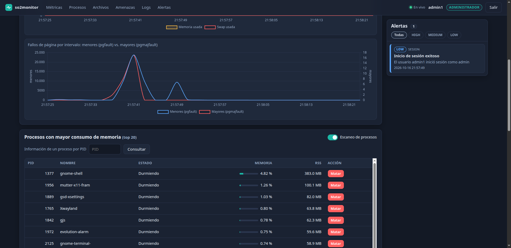
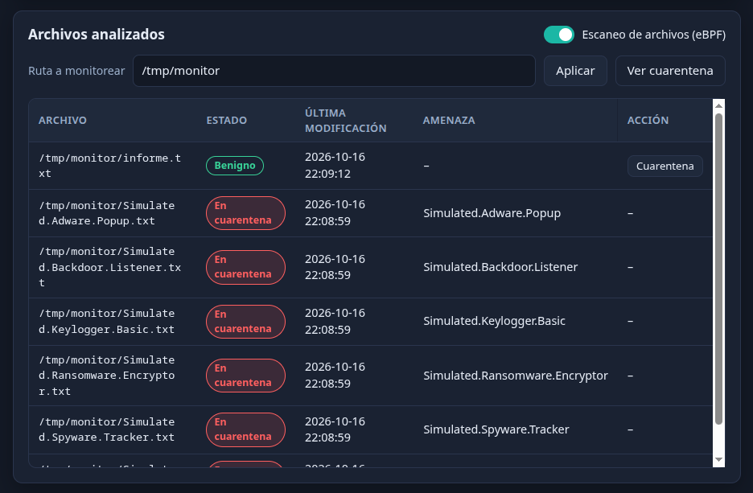
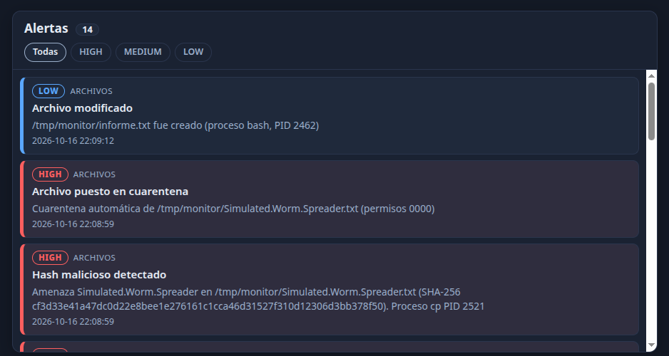
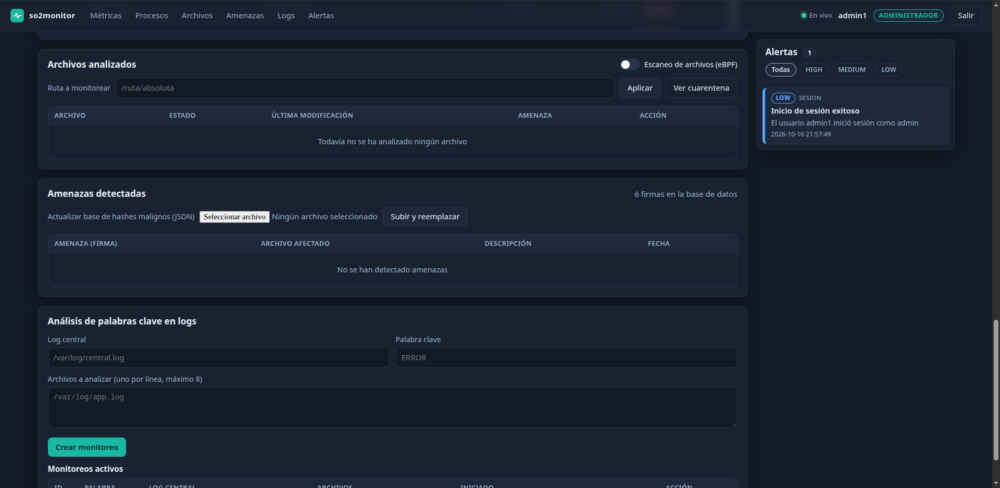
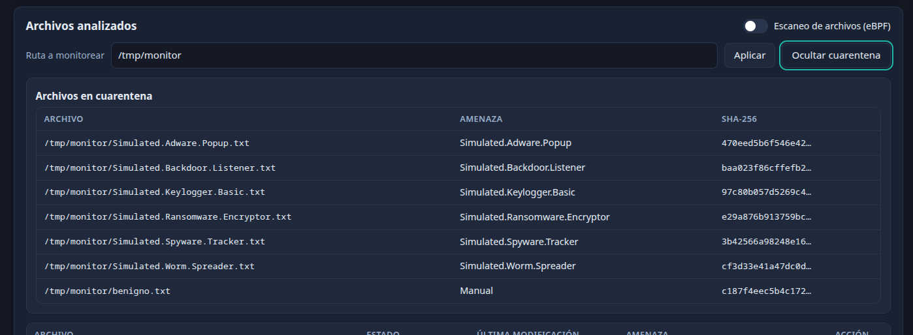
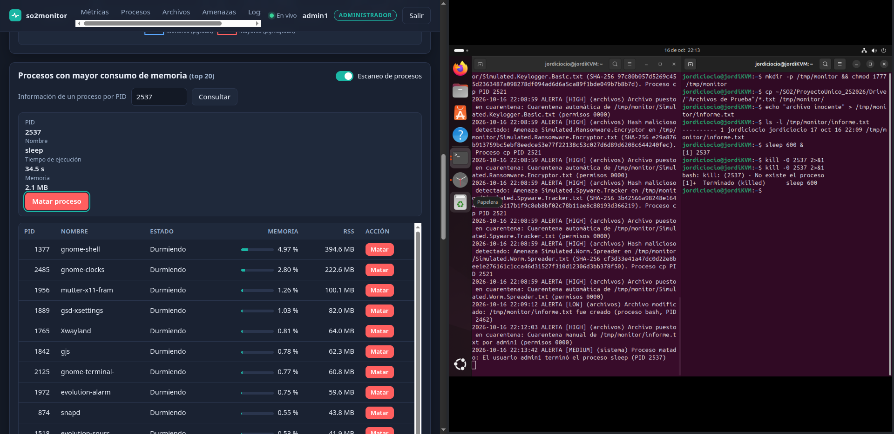
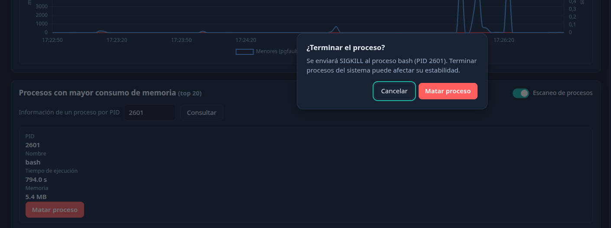
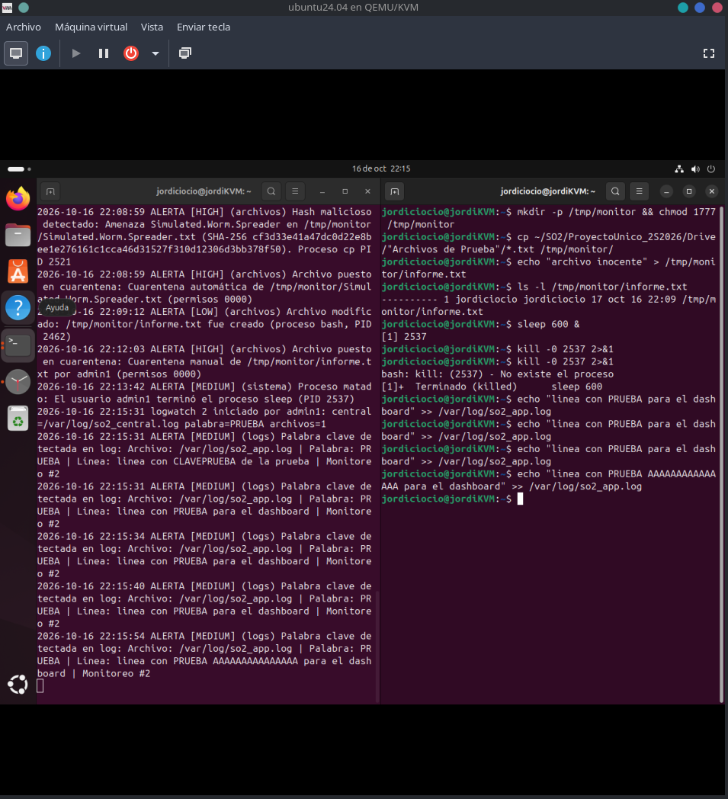
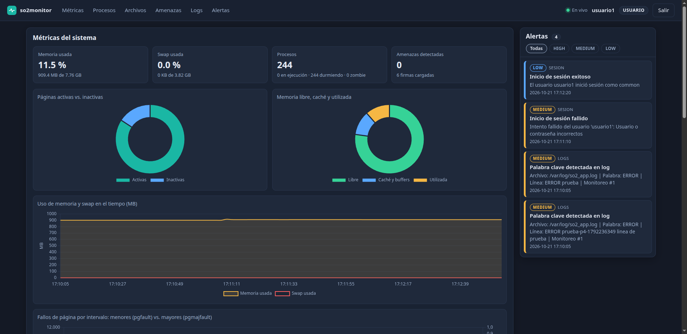
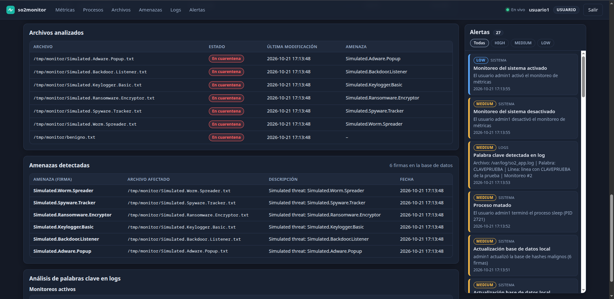

# Manual de Usuario — so2monitor

Sistema Integral de Monitoreo y Seguridad del Sistema Operativo · Sistemas Operativos 2 · Carné 202200389

Este manual explica cómo **encender el sistema, iniciar sesión y usar el dashboard**, tanto como administrador como
usuario común. Para los detalles de implementación consulte el [Manual Técnico](Manual_Tecnico.md).

---

## Índice

1. [¿Qué hace el sistema?](#1-qué-hace-el-sistema)
2. [Antes de empezar](#2-antes-de-empezar)
3. [Encender el sistema](#3-encender-el-sistema)
4. [Iniciar sesión y roles](#4-iniciar-sesión-y-roles)
5. [Recorrido por el dashboard](#5-recorrido-por-el-dashboard)
6. [Tareas del administrador](#6-tareas-del-administrador)
7. [Lo que ve el usuario común](#7-lo-que-ve-el-usuario-común)
8. [Apagar el sistema](#8-apagar-el-sistema)
9. [Problemas frecuentes](#9-problemas-frecuentes)

---

## 1. ¿Qué hace el sistema?

so2monitor vigila un equipo Linux y lo muestra en una página web en tiempo real:

- **Recursos:** memoria, swap, fallos de página y los procesos que más memoria consumen.
- **Archivos:** detecta cuándo se escribe un archivo en una carpeta vigilada, calcula su huella SHA-256 y la compara con
  una base de amenazas conocidas. Si coincide, el archivo se aísla (cuarentena) automáticamente.
- **Logs:** avisa cuando aparece una palabra clave (por ejemplo `ERROR`) en un archivo de registro.
- **Alertas:** cada hallazgo genera una alerta con severidad **LOW** (informativa), **MEDIUM** (advertencia) o
  **HIGH** (crítica).

Hay dos tipos de usuario: el **administrador**, que puede controlar el sistema, y el **usuario común**, que solo observa.

## 2. Antes de empezar

Se necesita:

- La máquina virtual Ubuntu con el kernel **`6.12.69-202200389-so2-final`** (se comprueba con `uname -r`).
- El programa `so2monitor` y la carpeta `Dashboard/` (vienen en el repositorio, dentro de `ProyectoUnico_2S2026/`).
- Un navegador web, en la propia máquina virtual o en el equipo anfitrión.
- Cuentas de usuario del sistema pertenecientes a los grupos `admin_user` o `common_user` (ver §3.2).

## 3. Encender el sistema

### 3.1 Arrancar con el kernel correcto

Al iniciar la máquina virtual, en el menú de GRUB elegir **Advanced options for Ubuntu** y luego
**Ubuntu, with Linux 6.12.69-202200389-so2-final**. Una vez dentro, comprobar:

```bash
uname -r                     # 6.12.69-202200389-so2-final
ls /sys/kernel/btf/vmlinux   # debe existir
hostname -I                  # anotar la dirección IP de la máquina virtual
```

### 3.2 Preparación inicial (solo la primera vez)

```bash
cd ~/SO2/ProyectoUnico_2S2026/ProgramaIntermedio
make                                          # compila el daemon (si no se usa el ejecutable incluido)
sudo ./scripts/instalar_sistema.sh            # crea los grupos, el servicio de autenticación y los logs de ejemplo
sudo ./scripts/crear_usuario.sh admin1 admin  # crea un administrador (pide una contraseña)
sudo ./scripts/crear_usuario.sh usuario1 common   # crea un usuario común (pide una contraseña)
```

Los usuarios se crean con `useradd` y pueden agregarse en cualquier momento, incluso con el sistema en marcha. Un usuario
que pertenezca a ambos grupos se trata como administrador; uno que no pertenezca a ninguno **no puede entrar**.

### 3.3 Iniciar el daemon

```bash
cd ~/SO2/ProyectoUnico_2S2026/ProgramaIntermedio
sudo ./so2monitor -f
```

La opción `-f` lo deja en primer plano y muestra su registro en pantalla. Sin `-f` se ejecuta en segundo plano
(registro en `/var/log/so2monitor.log`). Al arrancar bien deben verse, entre otras, estas líneas:

```text
blacklist: 6 firmas cargadas
sensor eBPF cargado (PID del daemon registrado: …)
hilo de monitoreo iniciado … hilo de archivos iniciado … hilo IPC iniciado: bloqueado en sys_ipc_channel_receive
HTTP: escuchando en el puerto 8080
```

El daemon necesita permisos de administrador (`sudo`) para cargar el sensor eBPF, autenticar usuarios y aislar archivos.

### 3.4 Abrir el dashboard

En el navegador, abrir `http://IP_DE_LA_MAQUINA_VIRTUAL:8080` (con la IP del paso 3.1), o `http://127.0.0.1:8080` si el
navegador está dentro de la propia máquina virtual.

## 4. Iniciar sesión y roles


Escribir el nombre de usuario y la contraseña de la cuenta del sistema y pulsar **Iniciar sesión**. Si los datos son
incorrectos, o la cuenta no pertenece a ningún grupo del sistema, se muestra un mensaje de error y se genera una alerta
MEDIUM «Inicio de sesión fallido».

Tras entrar, la barra superior muestra el estado de la conexión (**En vivo** en verde), el nombre de usuario y su rol
(**ADMINISTRADOR** o **USUARIO**). El botón **Salir** cierra la sesión (la sesión también caduca a las 8 horas).

| | Administrador | Usuario común |
|---|:--:|:--:|
| Ver métricas, procesos, alertas y archivos analizados | ✔ | ✔ |
| Ver amenazas detectadas y monitoreos de logs activos | ✔ | ✔ |
| Activar/desactivar el monitoreo de métricas y el escaneo de procesos | ✔ | ✘ |
| Activar/desactivar el escaneo de archivos y elegir la carpeta vigilada | ✔ | ✘ |
| Actualizar la base de hashes malignos | ✔ | ✘ |
| Consultar un proceso por PID y terminarlo | ✔ | ✘ |
| Poner archivos en cuarentena y ver la cuarentena | ✔ | ✘ |
| Crear y finalizar monitoreos de logs | ✔ | ✘ |

El sistema **rechaza** estas acciones al usuario común aunque se intente forzarlas: no basta con que los botones estén
ocultos.

## 5. Recorrido por el dashboard

La barra superior permite saltar a cada sección (Métricas, Procesos, Archivos, Amenazas, Logs, Alertas). El panel de
**Alertas** queda fijo a la derecha. Todo se actualiza solo, sin recargar la página.

### 5.1 Métricas del sistema


Las cuatro tarjetas resumen el estado: **memoria usada** (porcentaje y cantidad), **swap usada**, **número de procesos**
(en ejecución, durmiendo, zombie) y **amenazas detectadas**. Debajo hay cuatro gráficas:

| Gráfica | Cómo leerla |
|---|---|
| **Páginas activas vs. inactivas** | Memoria usada recientemente (*activa*) frente a la que lleva tiempo sin tocarse (*inactiva*); la inactiva es la primera que el sistema recupera si falta memoria |
| **Memoria libre, caché y utilizada** | Reparto de la RAM. La **caché** es memoria que el sistema usa para acelerar el disco y que puede liberar al instante, por eso una caché alta no es un problema |
| **Uso de memoria y swap en el tiempo** | Evolución en MB. Una línea de swap que sube de forma sostenida indica que la RAM no alcanza |
| **Fallos de página: menores vs. mayores** | Los **menores** (`pgfault`) se resuelven en memoria y son normales; los **mayores** (`pgmajfault`) obligan a leer del disco y, si son frecuentes, el equipo va lento. Se muestra la cantidad ocurrida en cada intervalo |

El administrador dispone además del interruptor **Monitoreo activo**: al desactivarlo las gráficas dejan de actualizarse
(se genera una alerta MEDIUM) y al activarlo vuelven a hacerlo (alerta LOW).

### 5.2 Procesos activos



La tabla muestra los **20 procesos que más memoria consumen**: PID, nombre, estado, porcentaje de memoria (con barra) y
RSS (la memoria física que ocupan). El administrador ve además la columna **Acción** con el botón **Matar**, el
interruptor **Escaneo de procesos** y un formulario para consultar un PID (ver §6.6).

### 5.3 Archivos analizados y amenazas



La tabla lista cada archivo que el sensor vio escribir en la carpeta vigilada, con su **estado**:

| Estado | Significado |
|---|---|
| **Benigno** (verde) | Su huella SHA-256 no coincide con ninguna amenaza conocida |
| **Infectado** (rojo) | Coincide con una amenaza pero todavía no se aisló |
| **En cuarentena** (rojo) | Se aisló: sus permisos son `0000` y nadie puede leerlo, escribirlo ni ejecutarlo |

También se muestran la fecha de última modificación y, si es malicioso, el nombre de la amenaza. La sección
**Amenazas detectadas** (más abajo) enumera cada hallazgo con el nombre de la firma, el archivo afectado, su descripción
y la fecha, e indica cuántas firmas tiene la base de datos.

### 5.4 Alertas



Cada alerta indica su **tipo** (archivos, sistema, sesión, logs), un título, una descripción, la **severidad** y la hora.
Las más recientes aparecen arriba y las críticas (HIGH) generan además un aviso emergente. Los botones **Todas / HIGH /
MEDIUM / LOW** filtran la lista.

| Severidad | Significado | Eventos |
|---|---|---|
| **LOW** (azul) · informativa | Algo ocurrió, sin riesgo | Archivo modificado · Monitoreo del sistema activado · Inicio de sesión exitoso |
| **MEDIUM** (ámbar) · advertencia | Merece atención | Monitoreo del sistema desactivado · Inicio de sesión fallido · Palabra clave detectada en log · Actualización de la base de datos local · Proceso matado |
| **HIGH** (rojo) · crítica | Requiere acción | Hash malicioso detectado · Archivo puesto en cuarentena |

### 5.5 Análisis de palabras clave en logs



Esta sección enumera los **monitoreos de logs activos**: cada uno con su identificador, la palabra clave, el archivo central
y los archivos vigilados. Cuando la palabra aparece en uno de los archivos, se genera una alerta MEDIUM «Palabra clave
detectada en log» que incluye el archivo y la línea.

## 6. Tareas del administrador

### 6.1 Elegir la carpeta vigilada y activar el escaneo de archivos

1. En **Archivos analizados**, escribir la **ruta absoluta** de la carpeta (por ejemplo `/tmp/monitor`) y pulsar **Aplicar**.
2. Activar el interruptor **Escaneo de archivos (eBPF)**.

Solo se vigilan los archivos que están **directamente** en esa carpeta, no los de sus subcarpetas. Desactivar el interruptor
detiene el sensor por completo.

### 6.2 Ver cómo se detecta una amenaza

Con el escaneo activo, copiar a la carpeta vigilada los archivos de prueba (carpeta `Drive/Archivos de Prueba/` del
repositorio):

```bash
cp ~/SO2/ProyectoUnico_2S2026/Drive/"Archivos de Prueba"/*.txt /tmp/monitor/
```

Sin recargar la página aparecen los archivos en la tabla, las amenazas con su nombre y las alertas HIGH «Hash malicioso
detectado» y «Archivo puesto en cuarentena». Un archivo normal, como `echo "hola" > /tmp/monitor/informe.txt`, aparece
como **Benigno** con una alerta LOW «Archivo modificado».

### 6.3 Poner un archivo en cuarentena manualmente

1. En la fila del archivo, pulsar **Cuarentena**.
2. Confirmar en el diálogo **¿Poner en cuarentena?**
3. El estado cambia a **En cuarentena** (alerta HIGH). El botón **Ver cuarentena** muestra la lista de archivos aislados.

Solo pueden aislarse archivos que el sistema ya haya analizado.



*La lista muestra cada archivo aislado con la amenaza que lo originó (o «Manual» si lo aisló el administrador) y el comienzo de
su SHA-256. El botón cambia a **Ocultar cuarentena**.*

### 6.4 Actualizar la base de hashes malignos

En **Amenazas detectadas**, pulsar **Seleccionar archivo**, elegir un archivo `.json` y pulsar **Subir y reemplazar**. El
archivo debe tener este formato (un objeto cuyas claves son los nombres de las amenazas):

```json
{
  "Nombre.De.La.Amenaza": {
    "hash": "470EED5B6F546E420020E5B6E0BC2813022334EEF3C0ED4794FE030EB7822ADB",
    "descripcion": "Texto explicativo"
  }
}
```

- `hash` es el SHA-256 de 64 caracteres hexadecimales (mayúsculas o minúsculas). Se obtiene con `sha256sum archivo`.
- Si el archivo no cumple el formato se rechaza con un mensaje y la base de datos actual **no se modifica**.
- Si es válido, reemplaza la base (alerta MEDIUM «Actualización base de datos local») y los archivos ya analizados se
  vuelven a evaluar: los que ahora coinciden se aíslan.

### 6.5 Escaneo de procesos

El interruptor **Escaneo de procesos** (sección Procesos) activa o desactiva la actualización periódica de la tabla.

### 6.6 Consultar y terminar procesos

1. En **Procesos**, escribir un **PID** en el formulario y pulsar **Consultar**: se muestra el nombre, el tiempo de
   ejecución y la memoria del proceso.
2. Para terminarlo, pulsar **Matar proceso** (o **Matar** en la fila de la tabla).
3. Se pide confirmación: *«Se enviará SIGKILL al proceso … Terminar procesos del sistema puede afectar su estabilidad»*.
   Pulsar **Matar proceso** para continuar.



*A la izquierda, el detalle del proceso con el botón «Matar proceso»; a la derecha, la terminal confirma que el proceso ya no existe.*



*El diálogo aparece sobre la consulta del PID; **Cancelar** descarta la acción.*

Por seguridad **no se puede terminar** el proceso con PID 1, el propio daemon ni los hilos del kernel. El sistema registra
una alerta MEDIUM «Proceso matado».

### 6.7 Crear y finalizar monitoreos de logs

1. En **Análisis de palabras clave en logs**, completar **Log central** (donde el sistema anota las coincidencias),
   **Palabra clave** y **Archivos a analizar** (uno por línea, hasta 8; todas las rutas deben ser absolutas).
2. Pulsar **Crear monitoreo**: aparece en **Monitoreos activos**.
3. Para probarlo, agregar una línea con la palabra clave al archivo vigilado:

   ```bash
   echo "ERROR acceso rechazado" >> /var/log/so2_app.log
   ```

4. En uno o dos segundos aparece una alerta MEDIUM con el archivo y la línea.
5. Para detenerlo, pulsar **Finalizar** en su fila y confirmar.



> Un monitoreo nuevo lee el archivo **desde el principio**: las líneas antiguas que contengan la palabra clave también
> generan alerta. Para empezar de cero, vaciar el archivo antes: `: > /var/log/so2_app.log`.

## 7. Lo que ve el usuario común



El usuario común ve las mismas **métricas, gráficas, tabla de procesos, archivos analizados, amenazas, monitoreos y alertas**,
actualizados en tiempo real, pero **no** tiene ningún control: no aparecen los interruptores (por ejemplo, *Monitoreo
activo* está ausente de la cabecera de Métricas), los botones **Matar** ni **Cuarentena**, la columna **Acción**, ni los
formularios de PID, ruta, base de hashes y monitoreos. Su insignia en la barra superior dice **USUARIO**.

Las dos capturas siguientes muestran el resto de la página para este rol. En **Procesos** la tabla no tiene la columna
**Acción** y no hay interruptor ni formulario de PID:


En **Archivos analizados**, **Amenazas detectadas** y **Monitoreos activos** solo hay tablas: no existen el formulario de ruta,
**Ver cuarentena**, la subida de la base de hashes ni el formulario para crear monitoreos:




## 8. Apagar el sistema

En la terminal donde corre el daemon, pulsar **Ctrl+C** (o, si se ejecutó en segundo plano,
`sudo kill $(cat /run/so2monitor.pid)`). El daemon detiene sus monitoreos de logs, desengancha el sensor y termina
ordenadamente.

## 9. Problemas frecuentes

| Síntoma | Causa y solución |
|---|---|
| «Address already in use» al arrancar | Otro programa usa el puerto 8080 (por ejemplo el daemon de la Práctica 4). Detenerlo y volver a iniciar |
| «failed to find valid kernel BTF» y no hay escaneo de archivos | La máquina virtual no arrancó con el kernel `…-so2-final`. Reiniciar y elegirlo en GRUB |
| No se puede entrar con una cuenta válida | La cuenta no pertenece a `admin_user` ni a `common_user`. Agregarla con `sudo usermod -aG admin_user NOMBRE` |
| El indicador dice «Reconectando…» | El daemon se detuvo o cambió la IP de la máquina virtual. Verificar con `hostname -I` y que el daemon esté en marcha |
| No aparecen archivos en la tabla | El escaneo está desactivado, o la carpeta configurada no es la que se usa. Los archivos en **subcarpetas** no se vigilan |
| Aparecen alertas de logs antiguas al arrancar | Normal: el monitoreo lee el archivo desde el principio. Vaciar el log (`: > ARCHIVO`) |
| Mover un archivo con `mv` no genera evento | Dentro del mismo disco `mv` solo renombra y no escribe el archivo. Usar `cp` |
