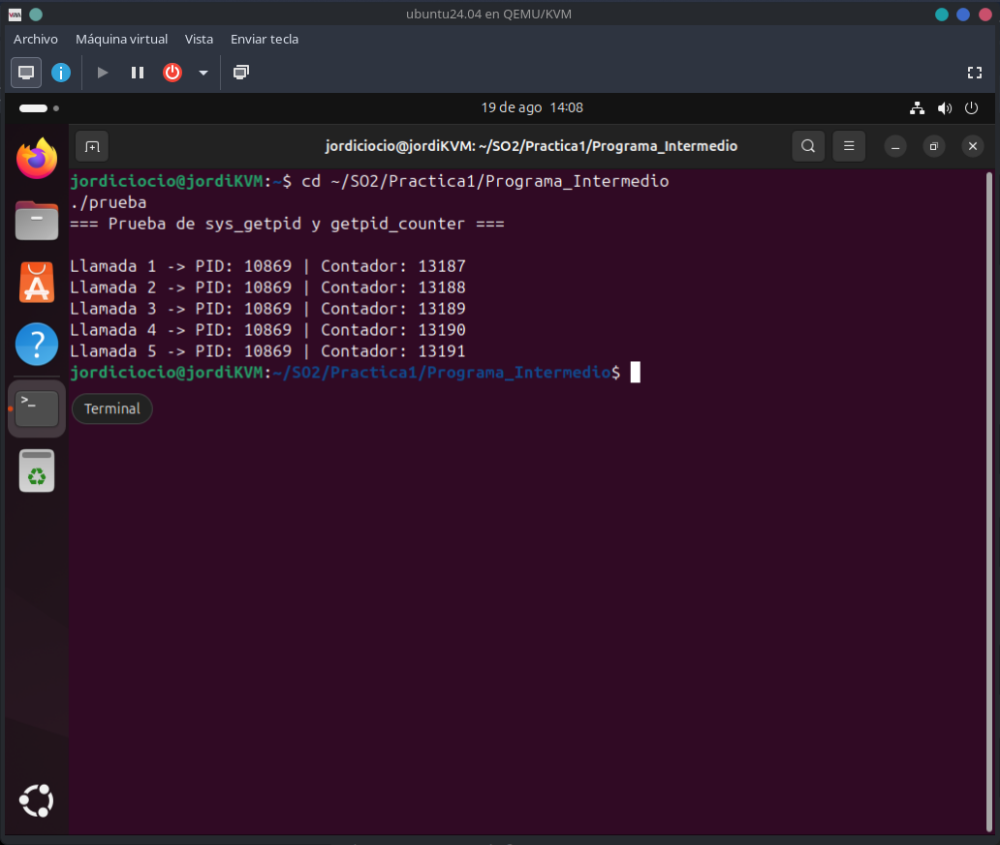
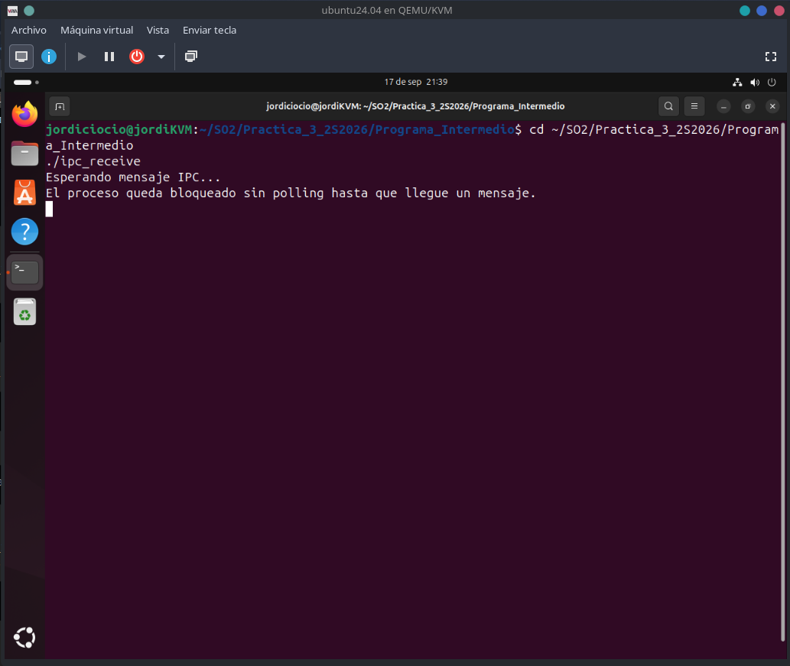
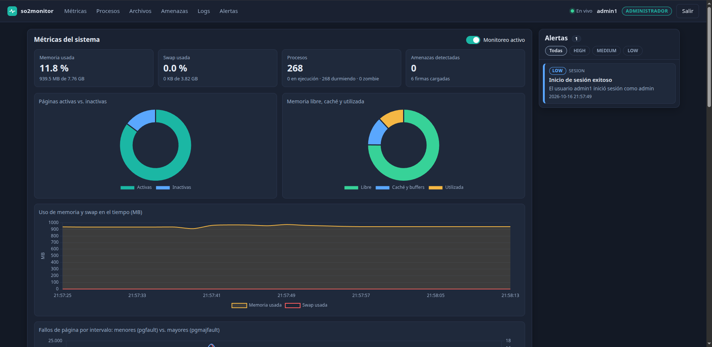

# Laboratorio de Sistemas Operativos 2 · 2S2026

Universidad de San Carlos de Guatemala · Facultad de Ingeniería · Ingeniería en Ciencias y Sistemas
Carné **202200389**

Cuatro prácticas y un proyecto final que parten del **mismo kernel**, Linux **6.12.69 LTS**, y construyen una sobre otra:
primero se modifica el kernel, luego se leen procesos, después se comunican procesos y se monitorean eventos, y al final todo
se integra en un sistema de monitoreo y seguridad con sensor eBPF, daemon en C y dashboard web.

```text
P1  contador en getpid + syscall
 └► P2  información de procesos
     └► P3  IPC bloqueante + monitoreo de logs (kthread)
         └► P4  integración P2 + P3: daemon en C y dashboard
             └► Proyecto final  + sensor eBPF, PAM, detección por hash, cuarentena
```

## Entorno

| | |
|---|---|
| **Kernel base** | Linux **6.12.69** (rama LTS, de kernel.org) |
| **Máquina virtual** | Ubuntu 24.04.4 LTS sobre QEMU/KVM + libvirt (virt-manager), 4 vCPU, 40 GB de disco |
| **Anfitrión** | Fedora 44 |
| **Lenguajes** | C (kernel, daemon, programas de prueba y sensor eBPF), JavaScript/HTML/CSS (dashboard) |
| **Nombre del kernel** | `6.12.69-202200389-so2[-pN \| -final]`: se compiló uno distinto por actividad (`uname -r` lo comprueba) |

## Resumen

| Actividad | Kernel compilado (`uname -r`) | Syscalls | Qué se construyó |
|---|---|---|---|
| [**Práctica 1**](Practica_1_2S2026/) | `6.12.69-202200389-so2` | `548 getpid_counter` | Contador atómico en `getpid()` y syscall para consultarlo |
| [**Práctica 2**](Practica_2_2S2026/) | `6.12.69-202200389-so2-p2` | `548 get_process_info` · `549 get_processes_state` | Información de un proceso y estado de todos los procesos |
| [**Práctica 3**](Practica_3_2S2026/) | `6.12.69-202200389-so2-p3` | `548 ipc_channel_send` · `549 ipc_channel_receive` · `550 start_log_watch` · `551 stop_log_watch` | Canal IPC bloqueante y monitor de logs con hilo del kernel |
| [**Práctica 4**](Practica_4_2S2026/) | `6.12.69-202200389-so2-p4` | `548–553` (P2 + P3 renumeradas) | Daemon en C + dashboard con eventos en tiempo real |
| [**Proyecto final**](ProyectoUnico_2S2026/) | `6.12.69-202200389-so2-final` | `548–553` (la 549 devuelve la lista por proceso) | Sensor eBPF, daemon con PAM, dashboard por roles, manuales |

> **Sobre los archivos del kernel.** Cada carpeta `linux 6.12.69/` contiene **solo los archivos modificados** (`kernel/sys.c`,
> `include/linux/syscalls.h` y `arch/x86/entry/syscalls/syscall_64.tbl`), con la estructura original del árbol. Para compilar
> hay que aplicarlos sobre un Linux 6.12.69 limpio; el proyecto final trae scripts que lo automatizan.

---

## Práctica 1 · Modificación del kernel

**Kernel:** `6.12.69-202200389-so2`

Se modificó `getpid()` para incrementar un contador global (`atomic64_t`) en cada llamada, y se agregó la syscall
**`getpid_counter` (548)**, que devuelve el valor acumulado y lo registra con `printk()`. Es la primera vez que se recorre el
ciclo completo: modificar fuentes → registrar la syscall → configurar → compilar → instalar → GRUB → probar desde espacio de
usuario.



- Programa de prueba en C y verificación con `dmesg`.
- 📄 [README de la práctica](Practica_1_2S2026/README.md) · [Informe técnico](Practica_1_2S2026/docs/Informe_Tecnico.md)

---

## Práctica 2 · Información de procesos

**Kernel:** `6.12.69-202200389-so2-p2`

Dos syscalls que leen estructuras internas del kernel y las entregan al usuario con `copy_to_user()`:

| N.º | Syscall | Devuelve |
|---:|---|---|
| 548 | `get_process_info(pid, *info)` | nombre, PID, tiempo de ejecución y memoria aproximada |
| 549 | `get_processes_state(*state)` | total de procesos y cuántos están en *Running*, *Sleeping/Idle* y *Zombie* |


- El recorrido de procesos usa `for_each_process`; el programa de prueba acepta un PID como argumento.
- 📄 [README de la práctica](Practica_2_2S2026/README.md) · [Informe técnico](Practica_2_2S2026/docs/Informe_Tecnico.md) · [Evidencias](Practica_2_2S2026/docs/EVIDENCIAS.md)

---

## Práctica 3 · Sincronización e instrumentación

**Kernel:** `6.12.69-202200389-so2-p3`

Dos mecanismos dentro del kernel:

1. **Canal IPC bloqueante.** Cola FIFO circular (16 mensajes de 256 bytes) protegida con *mutex*; el receptor duerme en una
   *wait queue* (`wait_event_interruptible`) **sin polling** hasta que llega un mensaje.
2. **Monitor de logs.** Un hilo del kernel (`kthread`) vigila hasta 8 archivos y escribe en un log central cada línea que
   contiene una palabra clave.

| N.º | Syscall |
|---:|---|
| 548 / 549 | `ipc_channel_send` / `ipc_channel_receive` |
| 550 / 551 | `start_log_watch` / `stop_log_watch` |



- Errores reales encontrados y corregidos: marcos de pila demasiado grandes (buffers pasados al *heap*), archivos truncados y
  un log que se monitoreaba a sí mismo.
- 📄 [README de la práctica](Practica_3_2S2026/README.md) · [Informe técnico](Practica_3_2S2026/docs/Informe_Tecnico.md) · [Errores](Practica_3_2S2026/docs/ERRORES.md) · [Guía de demostración](Practica_3_2S2026/GUIA_DEMOSTRACION.md)

---

## Práctica 4 · Integración con daemon y dashboard

**Kernel:** `6.12.69-202200389-so2-p4` (compilado sin BTF)

Integra las syscalls de las prácticas 2 y 3 en un sistema de monitoreo. La numeración final es
`548 get_process_info · 549 get_processes_state · 550 ipc_channel_send · 551 ipc_channel_receive · 552 start_log_watch ·
553 stop_log_watch`. Cuando `log_watch` detecta la palabra clave, un *helper* interno del kernel encola el aviso en la cola IPC
**sin pasar por `copy_from_user`**; el daemon, dormido en la 551, despierta y lo empuja al navegador al instante.


- **Daemon en C** (`so2_p4`): hilos de monitoreo, IPC y HTTP; `/proc/meminfo`, tabla de procesos y JSON por HTTP/SSE.
- **Dashboard** con las 5 visualizaciones del enunciado: pie de memoria, líneas de memoria vs. swap, tabla de procesos, panel de
  eventos de seguridad en tiempo real y consulta por PID.
- Pruebas automáticas: **20 de 20** en la VM con el kernel de la práctica 4.
- 📄 [README de la práctica](Practica_4_2S2026/README.md) · [Guía del daemon y dashboard](Practica_4_2S2026/docs/GUIA_DAEMON_DASHBOARD_P4_202200389.md) · [Informe técnico](Practica_4_2S2026/docs/Informe_Tecnico_P4_202200389.md)

---

## Proyecto final · Sistema integral de monitoreo y seguridad

**Kernel:** `6.12.69-202200389-so2-final` (con `CONFIG_DEBUG_INFO_BTF=y`, eBPF y `FTRACE_SYSCALLS`)

Reutiliza las syscalls 548–553 (la 549 se amplió para devolver la lista por proceso) y agrega la capa de seguridad:

- **Sensor eBPF** (Clang + libbpf, CO-RE): intercepta la escritura de archivos en un directorio configurado y envía los
  metadatos por un *ring buffer*. Hace solo filtrado por ruta; ignora los eventos del propio daemon.
- **Daemon en C** con tres hilos (monitoreo, archivos eBPF, canal IPC): calcula **SHA-256**, lo compara con una *blacklist*,
  pone en cuarentena (`chmod 0000`) y genera alertas **LOW / MEDIUM / HIGH**.
- **Autenticación con PAM** y roles `admin_user` / `common_user`, con los permisos aplicados en el daemon.
- **Dashboard web** en tiempo real que adapta lo que muestra según el rol.



- Pruebas automáticas de extremo a extremo: **58 de 58**.
- 📄 [README del proyecto](ProyectoUnico_2S2026/README.md) · [Manual técnico](ProyectoUnico_2S2026/docs/Manual_Tecnico.md) · [Manual de usuario](ProyectoUnico_2S2026/docs/Manual_Usuario.md) · [**Guía de instalación desde cero**](ProyectoUnico_2S2026/docs/Guia_Instalacion_Desde_Cero.md)

---

## Estructura del repositorio

```text
.
├── Practica_1_2S2026/        modificación del kernel (getpid_counter)
├── Practica_2_2S2026/        información de procesos
├── Practica_3_2S2026/        IPC bloqueante y monitoreo de logs
├── Practica_4_2S2026/        integración: daemon (daemon/) y dashboard (dashboard/)
└── ProyectoUnico_2S2026/     proyecto final
    ├── Kernel/               archivos modificados del kernel
    ├── ProgramaIntermedio/   daemon, sensor eBPF, configuración y scripts
    ├── Dashboard/            frontend
    ├── docs/                 manuales y guía de instalación
    ├── scripts/              compilación e instalación del kernel
    └── img/                  capturas
```

Cada carpeta tiene su propio `README.md` con los detalles, el procedimiento y las evidencias.
